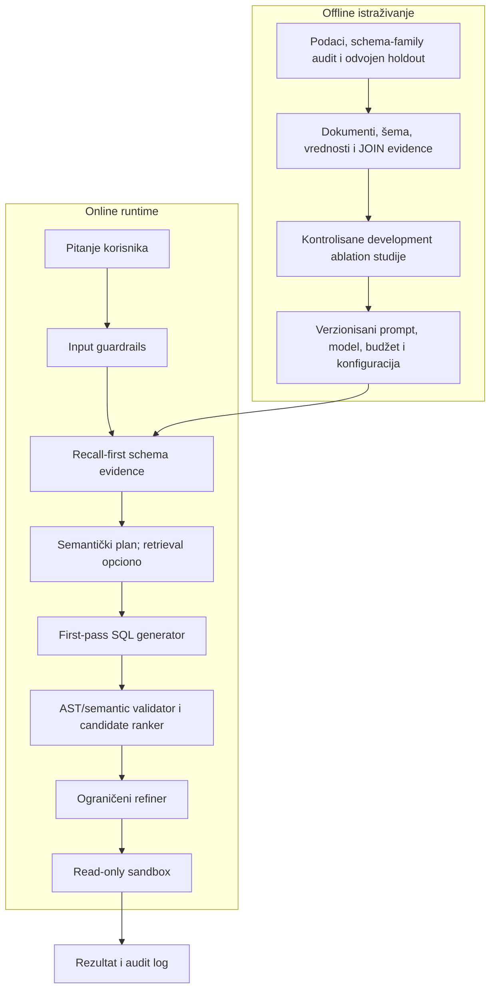

# Text-to-SQL master projekat: arhitektura i roadmap

**Tema:** Prevođenje prirodnog jezika u SQL upite korišćenjem velikih jezičkih modela
**Verzija plana:** 4.10
**Datum:** 13. oktobar 2026.
**Status projekta:** Faze 0-6, RUN-001 i RUN-002 su `DONE`. Originalni finalni run v2 ima svih 624 predikcija i statističku analizu; B6R je najbolji sa 34/104 (32,69%). Faza 7 ostaje `IN PROGRESS` zbog preostalog analitičkog closeout-a. Aktivni nastavak su nove Faze 7A-7E: protokol i dijagnostika, kompletan ulaz/izlaz modela, semantička tačnost, ograničena korekcija i nova finalna evaluacija. Semantičko planiranje je vraćeno u aktivni backlog.
**Poslednja provera:** 13. oktobar — GEN-001 offline response/contract/JSON/plan/SQL/sandbox/scoring integracija i durable resume rehearsal završeni; 353/353 testova prolazi (12 novih). Feasibility gate nije prošao: 29/31 pitanja ima uočene nedostajuće operacije, jedno nerešenu interpretaciju i jedno nedokazanu pokrivenost; nema nezavisno pregledanih benchmark contract-a. Bez pravih contract-a već 11/31 zahteva prelazi recorded 7200-token limit (maksimum 8035). Grounded v2 C2 13/31 ostaje baseline; nema novog model rezultata. [GEN-001 offline audit](gen001-offline-preflight-2026-10-13.md).

**Sledeći konkretan rad:** ne pokretati model run za trenutni semantic-plan-v1. GEN-001 ostaje IN PROGRESS zbog coverage/provenance/quota gate-ova. Sledeći mogući engineering milestone je zasebna v2 podrška za generalne arithmetic/conditional/window/date operacije, sintetička provera i ponovljen coverage/quota audit; bez arbitrary-SQL fallback-a ili ID-specifičnih pravila. Potrebno je posebno rešiti poreklo nezavisnog task contract-a. Nema novog API direktorijuma niti komande za generation.

**API izvršavanje:** sve model API pozive pokreće isključivo korisnik; asistent priprema kod/komande i radi lokalne testove. Raniji v1 probe `recovery-grounded001` je zaustavljen: dva neuspeha konekcije i jedan završen odgovor, bez zaključka o tačnosti. Journal i izvorni promptovi su sačuvani; taj direktorijum se ne nastavlja sa novim kodom. Plaćeni koraci zahtevaju prethodno obaveštenje korisniku, bez automatskog upgrade-a ili paid fallback-a.

**API pozivi ne znače obavezno plaćanje:** `openai/gpt-oss-120b` je dostupan na Groq Free planu. Objavljeni limiti su 30 zahteva/min, 1.000 zahteva/dan, 8.000 tokena/min i 200.000 tokena/dan; proveriti stvarne limite organizacije pre run-a. Planiranih 93 početna zahteva može se rasporediti preko više dana, uz pauzu i resume umesto upgrade-a. [Zvanični Groq limiti](https://console.groq.com/docs/rate-limits). Podrazumevani nastavak je bez plaćanja; $3 iz ranijeg draft-a nije potrebna uplata niti odobrenje troška. Plaćeni plan/trošak zahteva zasebno obaveštenje i odobrenje korisnika. Postojeći `paid_runs_enabled` flag istorijski meša live pristup i trošak; runner mora jasno razdvojiti dozvolu API poziva od dozvole plaćanja. Ovaj dokumentacioni update ne omogućava niti pokreće API pozive.

Prethodni run-ovi, freeze-ovi i istorijski dnevnik ostaju dokaz ranijih odluka. Novi plan ima prednost nad njihovim tadašnjim instrukcijama „sledeće” i „test je zatvoren”; postojeći test je sada otvoren i pregledan. Metodološka odluka je zabeležena u [ADR-021](decisions.md#adr-021---prioritize-semantic-correctness-after-the-completed-final-evaluation).

### Istorija verzija

| Verzija | Datum | Promena |
|---|---|---|
| 4.10 | 13. oktobar 2026. | GEN-001 offline runner i resume/scoring rehearsal; 353 testa; coverage/contract/quota gates failed, bez novog model run-a. |
| 4.9 | 13. oktobar 2026. | SEM-002 offline v1, typed contract/checker i ograničeni SQL compiler; 341 test, sintetički SAFE-002 rehearsal; GEN-001 coverage/provenance/quota gate-ovi ostaju. |
| 4.8 | 13. oktobar 2026. | Calculation004 12/31 naspram 13/31; promotion odbijen, grounded v2 C2 ostaje; proverena analiza bez API poziva ili izmene frozen izvora. |
| 4.7 | 12. oktobar 2026. | Završen grounded002 C2 13/31; validator v2, odvojena reevaluacija, 315 testova i pripremljen calculation004 single-factor eksperiment. |
| 4.6 | 11. oktobar 2026. | Završen baseline 7/31, 5/31, 9/31; grounded-sqlite-v2, 302 testa, audit 31 prompta i 93-request offline rehearsal; sve model API pozive pokreće korisnik. |
| 4.5 | 3. oktobar 2026. | Korisnikov live run 47/93; ispravljen dnevni quota accounting uz očuvanje odgovora i operational amendment; 285 testova; nastavak istog run-a, zatim scoring. |
| 4.4 | 3. oktobar 2026. | Runnable Free CLI: prepare/generate-resume/status/score; zamrznuti resursi i execution limiti, 281 test, 93-request mock rehearsal; bez Groq poziva ili novih model skorova. |
| 4.3 | 3. oktobar 2026. | Ispravljeno API = paid: EXP-002 može koristiti Groq Free uz pacing/resume; runner integracija i testiranje ostaju besplatan sledeći zadatak; $3 nije obavezna uplata. |
| 4.2 | 3. oktobar 2026. | Offline nastavak: DATA-004/005 i početni SEM-001 corpus DONE; OPS/EXP/REPRO IN PROGRESS; 454 exclusions, 155+104 diagnostic records, tri disabled konfiguracije, 266 testova, bez model poziva. |
| 4.1 | 3. oktobar 2026. | LLM-003/CTX-001 DONE; DATA-004/005 IN PROGRESS; offline protokol, 31 prompt i family audit; 240 testova, bez novih model poziva/skorova. |
| 4.0 | 2. oktobar 2026. | Evidentiran završen RUN-002 v2; review 34/104 i 49 semantic/result mismatch grešaka; aktivirane Faze 7A-7E, SEM-001/002 i GEN-001; novi taskovi za truncation, dokumente, schema-family audit, grounding, repair i novu evaluaciju. |
| 3.14 | 19. septembar 2026. | RUN-001 DONE: šest finalnih arm-ova, unapred definisana statistika, deterministički manifest i 209 testova. Sledeći je RUN-002. |
| 3.13 | 19. septembar 2026. | SEC-001/SEC-002 DONE: checksumovan 16-case corpus, S0/S1 guardrails/report, 198 testova. Sledeća je Faza 7. |
| 3.12 | 14. septembar 2026. | REF-001 DONE: verifikovan B7 5/31, sa 26 generation failures; checksum manifest, 193 testa i closeout. Sledeća je bezbednosna evaluacija, Faza 6. |
| 1.0 | 13. avgust 2026. | Početna arhitektura, roadmap i backlog |
| 1.1 | 13. avgust 2026. | Evidentirana implementacija Faze 0, ažurirani statusi i dodat dnevnik napretka |
| 1.2 | 13. avgust 2026. | Zatvoren `SEC-000`: potvrđeno da `.env` nije verzionisan i da su ključevi i kredencijali zamenjeni |
| 1.3 | 13. avgust 2026. | Ponovo potvrđen `SEC-000`, verifikovani testovi i CLI demo, dodato uputstvo za pokretanje aktuelne Phase 0 verzije |
| 1.4 | 13. avgust 2026. | Završen `DATA-001`: zamrznut Spider2-Lite SQLite protokol, DB-disjoint split 31/104, checksumovi i automatizovana leakage validacija |
| 1.5 | 17. avgust 2026. | Završen `DATA-003`: checksum-gated Spider2-Lite metadata loader, deterministički manifest/JSONL, 31/104 runtime firewall i 14 automatizovanih testova |
| 1.6 | 17. avgust 2026. | Završen `EVAL-001`: izolovano SQLite izvršavanje, Spider2-kompatibilno poređenje, strukturirani rezultat, exact-ID coverage i 25 testova |
| 1.7 | 18. avgust 2026. | Dodat `EVAL-002` resolver/protected-reference/preflight/batch runner i 43 testa; ispravljen status Faze 1 na BLOCKED nakon resource audita pinned snapshot-a |
| 1.8 | 18. avgust 2026. | Dozvoljen paralelni offline rad na LLM-002; dodat standard-library Groq adapter i 4 offline testa; realni scoring ostaje blokiran EVAL-002 resursima |
| 1.9 | 18. avgust 2026. | Završen offline deo LLM-002: Groq CLI, audit metadata, bounded retry, aktivni model config i 49 testova |
| 2.0 | 18. avgust 2026. | Dodat primarni EVAL-003 nad official execution-result CSV-ovima; 31/31 preflight je ready i strict SQL putanja je opciona |
| 2.1 | 18. avgust 2026. | `urllib` zamenjen official Groq SDK 1.6.0 transportom; uspešan `openai/gpt-oss-120b` live smoke i 55/55 testova |
| 2.2 | 29. avgust 2026. | Implementiran EXP-001 offline foundation: frozen B0/B1 TOML, seed, resumable exact-coverage runner, automatski scoring, resource manifest i 60 testova |
| 2.3 | 29. avgust 2026. | Završen EXP-001 live run: 31/31 B0 i 31/31 B1 predikcija, B0 0%, B1 16,13%, scored report-i i checksumovani artefakti |
| 2.4 | 29. avgust 2026. | Završen SCHEMA-001: verzionisan kanonski model, SQLite PK/FK/default metadata, validacija identifikatora, stabilni hash-evi za 6 baza i 65 testova |
| 2.5 | 29. avgust 2026. | Implementiran offline SCHEMA-002: XiYan-kompatibilan M-Schema, bounded read-only sampling, frozen B2 config/runner i stabilni hash-evi za 6 baza; live B2 poređenje čeka autorizaciju |
| 2.6 | 29. avgust 2026. | Završen SCHEMA-002 live B2: 31/31 predikcija, 2/31 tačna (6,45%), 22/31 executable, 107.586/13.417 input/output tokena i checksumovani artefakti |
| 2.7 | 30. avgust 2026. | Implementiran LINK-001 offline: extractive-lexical-v1, PK/FK closure, recall-safe fallback, frozen B6, 31-example reduction audit, ADR-009 i 85 testova; live B6 ostaje sledeći korak |
| 2.8 | 30. avgust 2026. | Završen LINK-001 live B6 sa negativnim rezultatom 1/31; dodat LINK-002/B6R recall-first hibrid, frozen exp004 config, 31-example offline audit, ADR-010 i 91 testova |
| 2.9 | 30. avgust 2026. | Završen LINK-002 live B6R: 31/31, 6/31 tačnih (19,35%), 25/31 executable, 94.140/15.806 tokena, analiza grešaka i checksumovani artefakti; Faza 3 zatvorena |
| 3.0 | 30. avgust 2026. | Završen RET-001: pinned official Spider 1.0 train, deterministički indeks 7.000 primera / 140 baza, checksum loader i potpuni Spider2 leakage firewall; 99 testova |
| 3.1 | 30. avgust 2026. | RET-002 offline deo verifikovan: B3 fixed-random i B4 TF-IDF cosine selektori, frozen exp005/exp006 konfiguracije, zajednički few-shot M-Schema prompt, deterministički 31-target auditi i 107 testova; live rezultati ostaju otvoreni |
| 3.2 | 31. avgust 2026. | Završen RET-002 live: B3 4/31, B4 5/31, oba 23/31 executable; prediction/report checksumovi, sanitized 429 dijagnostika i 108 testova; sledeći je DSPY-001/B5 |
| 3.3 | 1. septembar 2026. | Implementiran DSPY-001 offline: frozen B5 signature/config, MIPROv2 execution metric, DB-disjoint 21/10 development split, audit CLI, artifact verifikacija, ADR-013 i 114 testova; paid compile ostaje otvoren |
| 3.4 | 1. septembar 2026. | DSPY-001 dobio token-aware Groq limiter: 8.000 TPM, 7.200 safe rolling budget, input+max-output rezervacije, observed-usage reconciliation, 429 retry-after i 119 testova |
| 3.5 | 2. septembar 2026. | Instaliran i pinovan Optuna 4.9.0 za MIPROv2; dodat dependency preflight pre paid poziva, requirements/config/manifest evidencija i 120 testova |
| 3.6 | 3. septembar 2026. | Dodat strogi per-run B5 replay cache: eksplicitni compatible resume, full identity/integrity kontrole, non-cacheable greške/truncation, odvojeno provider računovodstvo, ADR-014 i 132 testa |
| 3.7 | 4. septembar 2026. | Završen DSPY-001/B5 sa negativnim rezultatom 4/31; B6R ostaje najbolji na 6/31. Faza 5 je preusmerena na eksplicitno semantičko planiranje i bolji single-query B7P pre validator/refiner sloja. |
| 3.8 | 7. septembar 2026. | Semantic-plan/B7P implementacija uklonjena sa master-a i odložena; vraćen originalni redosled Faze 5: SAFE-001, SAFE-002, zatim B7 kandidat/ranker/refiner |
| 3.9 | 7. septembar 2026. | Završen SAFE-001: parser/AST artefakt, stroga one-SELECT politika, SQLite prepare-time authorizer nad praznom kanonskom šemom, CLI i 144 testa; sledeći je SAFE-002 |
| 3.10 | 13. septembar 2026. | Završen SAFE-002: Linux worker, hash handoff i ponovna validacija snapshot-a, timeout/memory/row/byte limiti, sanitizovane greške, CLI i 20 novih testova; sledeći je REF-001 |
| 3.11 | 13. septembar 2026. | REF-001 offline: B7 config nad B6R, tri kandidata, deterministički ranker, jedna korekcija, call journal/budžet/resume i 23 testa; live development evaluacija ostaje otvorena |

## 1. Svrha dokumenta

Ovaj dokument definiše ciljnu arhitekturu, strukturu repozitorijuma, eksperimentalni plan i roadmap projekta. Koristi se kao centralno mesto za:
- praćenje napretka implementacije;
- beleženje eksperimentalnih odluka;
- razdvajanje prototipa od reproduktivnog istraživačkog koda;
- povezivanje implementacije sa istraživačkim pitanjima master rada;
- evidentiranje rezultata, rizika i blokera.

Statusi zadataka:

- `NOT STARTED` - rad nije započet;
- `IN PROGRESS` - trenutno se radi;
- `BLOCKED` - postoji zavisnost ili problem koji sprečava nastavak;
- `DONE` - zadatak ispunjava definisani Definition of Done;
- `DEFERRED` - svesno pomeren iz trenutnog obima.
- `OPTIONAL` - podržana ili planirana audit putanja koja ne blokira primarni projekat.

## 2. Cilj i granice projekta

### 2.1 Glavni cilj

Razviti reproduktivan i bezbedan Text-to-SQL sistem koji prima pitanje na prirodnom jeziku i metapodatke o bazi, bira relevantne delove šeme i few-shot primere, generiše SQL, proverava ga i kontrolisano ga izvršava u sandbox okruženju.

Sistem treba eksperimentalno da proceni doprinos sledećih komponenti, uključujući negativne rezultate; završetak komponente ne podrazumeva poboljšanje tačnosti:

1. uključivanje šeme baze u prompt;
2. M-Schema reprezentacija;
3. preuzimanje sličnih primera;
4. DSPy optimizacija prompta;
5. extractive schema linking;
6. validacija, izbor kandidata i korekcija SQL-a;
7. bezbednosne kontrole pre izvršavanja.
8. dostupna dokumentacija, relevantne vrednosti i proverene JOIN veze;
9. eksplicitni semantički plan i provere izvršivog, ali pogrešnog SQL-a.

Novi cilj je merljivo poboljšanje u odnosu na korigovani baseline, uz prihvatljivu cenu i verodostojnu evaluaciju. Plan ne garantuje određeni procenat tačnosti. U postojećem B6R rezultatu 49/70 neuspeha su izvršivi upiti sa pogrešnim rezultatom; samo popravka sintakse nije dovoljan kriterijum uspeha.

### 2.2 Van osnovnog obima

Sledeće stavke nisu deo minimalno uspešnog master projekta i implementiraju se samo ako ostane dovoljno vremena:

- treniranje velikog jezičkog modela od nule;
- kompletna reprodukcija CHASE-SQL ili MAC-SQL arhitekture;
- podrška za sve Spider 2.0 dijalekte u prvoj verziji;
- automatsko izvršavanje DDL, DML i administrativnih komandi;
- produkciona autentifikacija, naplata i multi-tenant infrastruktura;
- kompleksan agent koji autonomno menja bazu ili projekat.

## 3. Istraživačka pitanja

| ID | Istraživačko pitanje | Primarne metrike |
|---|---|---|
| RQ1 | Koliko uključivanje šeme baze poboljšava uspešnost u odnosu na generisanje samo iz pitanja? | Execution Accuracy, Valid SQL Rate |
| RQ2 | Da li M-Schema i extractive schema linking poboljšavaju tačnost i smanjuju broj tokena? | Execution Accuracy, Schema Recall/F1, Input Tokens |
| RQ3 | Koliko similarity-based few-shot i DSPy optimizacija poboljšavaju statički prompt? | Execution Accuracy, cena, latencija |
| RQ4 | Koliko verifier/refiner povećava tačnost i popravlja nevalidne upite? | Repair Success Rate, Pass@k, Execution Accuracy |
| RQ5 | Koliko guardrails smanjuju uspešnost napada bez odbijanja legitimnih pitanja? | Attack Success Rate, Unsafe Query Rate, False Positive Rate |
| RQ6 | Koliko dokumentacija, value/join grounding i semantički plan popravljaju značenje početnog SQL upita? | Execution Accuracy, non-empty correctness, semantičke kategorije, dobijeni/izgubljeni primeri |

## 4. Ciljna arhitektura

Arhitektura je podeljena na offline istraživački deo i online runtime. Offline deo priprema podatke, šeme, retrieval indeks i optimizovani prompt. Online deo koristi zamrznute artefakte i bezbedno obrađuje novo pitanje.



### 4.1 Tok jednog zahteva

1. Sistem prima pitanje, identifikator baze i SQL dijalekt.
2. Input guard proverava prazan ili predugačak unos, PII i obrasce prompt injection napada.
3. Recall-first schema evidence builder zadržava kompletan kompaktni inventar identifikatora i dodaje detalje samo za najrelevantnije tabele; reprezentativne vrednosti se uključuju selektivno, ne podrazumevano.
4. Semantički planner eksplicitno određuje izlazne kolone, izvore, JOIN putanje, filtere, agregacije, vremensku logiku, sortiranje/limit i posebne konstrukcije kao što su rekurzija ili skupovne operacije.
5. Ako je retrieval uključen u konfiguraciju, koristi tip operatora i SQL skeleton plana da pronađe strukturno slične trening primere koji prolaze schema-family/provenance firewall.
6. First-pass composer dobija pitanje, provereni semantički plan, schema evidence i mali broj strukturnih demonstracija i generiše jedan SQL kandidat.
7. Provider odgovor mora imati zabeležen completion status; nepotpun SQL nije kompletna predikcija. Unapred definisana politika ograničava eventualno povećanje budžeta/ponavljanje, zadržava pokušaje i razlikuje truncation od odbijenog HTTP zahteva.
8. Determinističke provere potvrđuju read-only AST, SQLite dijalekt, postojeće identifikatore, povezivost JOIN grafa i pokrivenost obaveznih stavki plana.
9. Kandidat se probno izvršava u read-only sandboxu sa timeoutom i ograničenjem redova.
10. Nova repair varijanta ima najviše jednu korekciju na osnovu konkretne sanitizovane greške ili proverljive povrede plana, čak i kada SQL može da se izvrši. Gold rezultat nije ulaz refiner-a.
11. Tek posle merljivog poboljšanja početnog upita opciona nova multi-candidate varijanta generiše do tri različita plana/kandidata. Završeni B7/REF-001 ostaje istorijski B6R-based eksperiment.
12. Rezultat, plan, izvori dokumentacije/evidence-a, completion status, svi pokušaji, razlog izbora, ukupna latencija sa čekanjem, tokeni, cena i hash konfiguracije upisuju se u audit log.

Ovo je ciljna arhitektura, ne tvrdnja o trenutnoj implementaciji: finalni B6R sada generiše jedan upit bez integrisanog planera, SAFE validacije ili repair-a. Dokumenti se dodaju uz korak 3; proverene veze i relevantne vrednosti imaju odvojeno poreklo i budžet. Retriever iz koraka 5 je opciona ablation komponenta i nije preduslov za prvi planer.

## 5. Moduli sistema

| Modul | Odgovornost | Ključni izlaz |
|---|---|---|
| Dataset loader | Učitava Spider 1.0/BIRD razvojne podatke i Spider 2.0 evaluacione zadatke | standardizovan `Example` objekat |
| Database registry | Povezuje `db_id`, dijalekt, konekciju, dokumentaciju i putanju baze | `DatabaseConfig` |
| Schema inspector | Čita tabele, kolone, tipove, PK/FK i dozvoljene vrednosti | kanonski schema model |
| M-Schema serializer | Pretvara kanonski model u stabilan tekstualni prikaz | M-Schema string |
| Schema linker | Izdvaja relevantne tabele i kolone | schema subset + score |
| Example retriever | Pronalazi top-k sličnih trening primera | lista few-shot primera |
| Semantic planner | Pre SQL-a razlaže pitanje na proverljivu relacionu nameru | typed semantic plan |
| First-pass composer | Prevodi plan i schema evidence u jedan SQLite upit | primarni SQL kandidat |
| Prompt program | Gradi prompt i čuva verziju instrukcije | kompletan prompt |
| DSPy optimizer | Optimizuje instrukciju i demonstracije na development skupu | zamrznut DSPy program |
| LLM provider | Jedinstven interfejs prema Groq/ostalim modelima | SQL kandidati + usage |
| SQL validator | AST validacija, allowlist i provera dijalekta | odluka + razlog |
| Refiner | Ograničena korekcija kandidata na osnovu greške | popravljeni kandidat |
| Sandbox executor | Read-only izvršavanje uz timeout i limit | redovi, kolone, greška, vreme |
| Evaluator | Zvanične i dodatne metrike, bootstrap intervali | rezultat eksperimenta |
| Experiment runner | Pokreće konfiguracije nad zamrznutim skupom | JSONL/CSV rezultati |
| Gradio UI | Demonstracija finalnog pipeline-a | interaktivni demo |

## 6. Predložena struktura repozitorijuma

```text
text2sql/
├── README.md
├── pyproject.toml
├── requirements.lock
├── .env.example
├── .gitignore
├── configs/
│   ├── models.yaml
│   ├── experiments/
│   └── security_policy.yaml
├── data/
│   ├── README.md
│   ├── raw/                 # nije u Git-u
│   ├── processed/           # nije u Git-u
│   └── fixtures/            # mali test primeri mogu u Git
├── src/text2sql/
│   ├── domain/              # zajednički modeli podataka
│   ├── datasets/            # Spider/BIRD loaderi
│   ├── schema/              # introspekcija, M-Schema, linking
│   ├── retrieval/           # embedding/skeleton retrieval
│   ├── prompting/           # prompt builder i DSPy program
│   ├── providers/           # Groq i drugi LLM adapteri
│   ├── validation/          # SQL AST i security policy
│   ├── execution/           # read-only sandbox
│   ├── evaluation/          # EX, EM, bezbednost, statistika
│   └── observability/       # audit log, tokeni, cena, latencija
├── experiments/
│   ├── run.py
│   ├── baselines/
│   └── ablations/
├── notebooks/
│   ├── legacy/              # postojeći notebookovi
│   └── analysis/            # samo analiza gotovih rezultata
├── app/
│   └── gradio_app.py
├── tests/
│   ├── unit/
│   ├── integration/
│   ├── security/
│   └── fixtures/
├── artifacts/
│   ├── prompts/
│   ├── retrieval/
│   └── reports/
└── docs/
    ├── architecture.md
    ├── experiments.md
    ├── decisions.md
    └── thesis-mapping.md
```

Pravila organizacije:

- produkcioni i eksperimentalni kod živi u `src/`, ne u notebookovima;
- notebookovi samo učitavaju već generisane rezultate radi analize i grafikona;
- svaki eksperiment koristi verzionisanu YAML konfiguraciju;
- sirovi skupovi, baze, API ključevi i veliki rezultati ne ulaze u Git;
- male test baze i sintetički primeri ostaju kao fixtures;
- svaki rezultat sadrži Git commit, model ID, seed, prompt ID i dataset verziju.

## 7. Standardni modeli podataka

Minimalni interni objekti treba da budu stabilni od početka projekta:

```python
Text2SQLExample(
    example_id: str,
    db_id: str,
    question: str,
    dialect: str,
    gold_sql: str | None,
    gold_result_path: str | None,
    split: str,
    metadata: dict,
)

GenerationResult(
    example_id: str,
    experiment_id: str,
    model_id: str,
    prompt_version: str,
    generated_sql: list[str],
    selected_sql: str | None,
    validation_status: str,
    execution_status: str,
    latency_ms: int,
    input_tokens: int,
    output_tokens: int,
    estimated_cost: float | None,
    error_category: str | None,
)
```

## 8. Eksperimentalne konfiguracije

| ID | Konfiguracija | Svrha |
|---|---|---|
| B0 | Samo originalno pitanje | dokumentuje slabost pristupa bez šeme |
| B1 | Pitanje + jednostavna puna šema | meri osnovni doprinos šeme |
| B2 | Pitanje + puna M-Schema | poredi reprezentacije šeme |
| B3 | M-Schema + random few-shot | kontroliše doprinos samih demonstracija |
| B4 | M-Schema + similarity few-shot | meri doprinos retrievera |
| B5 | B4 + DSPy optimizovan program | meri automatizovanu optimizaciju prompta |
| B6 | B2 + extractive schema linking (frozen prototype) | meri fokusiranje šeme i broj tokena |
| B6R | B6 recall repair + full compact schema | meri da li zaštita identifier recall-a popravlja B6 |
| B7P | Planirana nova single-query varijanta sa semantičkim planom; retrieval nije obavezan | development rad GEN-001, bez prepisivanja ranijih arm-ova |
| B7 | Završeni B6R + tri strategije + validator/ranker + najviše jedan repair | istorijski REF-001: 5/31, operativno degradiran run |
| S0 | SAFE-001 + SAFE-002 nad zadatim sintetičkim kandidatima | završeni provider-free security baseline |
| S1 | S0 + input i output guardrails | završena fixture evaluacija, nije end-to-end LLM test |

Stari B0-B7 rezultati i konfiguracije ostaju istorijski. Novi arm-ovi dobijaju nove ID-jeve, direktorijume, source/config/resource hash-eve i zajedničku SQLite/task instrukciju. Korigovani compact-schema baseline koristi iste dozvoljene dokumente i isti provider/error ugovor kao njegovi tretmani. Arhitekturna poređenja fiksiraju model i generation parametre; model-setting poređenja menjaju po jedan parametar.

Minimalni redosled novih development poređenja:

| Korak | Kontrola / promena | Uslov |
|---|---|---|
| C0 | Kompletna compact šema, dozvoljeni dokumenti, proverena completion evidencija | LLM-003, CTX-001, OPS-001; dokumentacija i politika odgovora su zajedničke svim narednim arm-ovima |
| C1 | Veći completion budget pri istom reasoning effort-u | početni kandidat 4.096; iznos se zamrzava tek posle quota preflight-a |
| C2 | Reasoning effort pri istom completion budget-u | low/medium kao početno poređenje; high ili 8.192 tokena samo kao posebno planiran nastavak |
| C3 | Relevantne vrednosti i proverene JOIN veze; linker promene odvojeno | odvojene ablation konfiguracije VALUE-001, JOIN-001 i LINK-003 |
| C4 / B7P | Typed semantic plan nad izabranim, fiksiranim kontekstom | SEM-002 i GEN-001; bez obaveznog novog retriever-a |
| C5 | Najviše jedan execution/semantic repair | REF-002; odvojeni first-pass i finalni rezultati |
| C6 / C7 | Strukturni retrieval / različiti kandidati | opcioni, međusobno odvojeni RET-003 i REF-003 eksperimenti |

C0-C7 su planske oznake, ne postojeće konfiguracije. Tačni ID-jevi, broj verzija/seed-ova, maksimalni pozivi/tokeni/trošak i pravilo selekcije zamrzavaju se pre svakog plaćenog poređenja. Veći model search (`MODEL-001`) i nova DSPy optimizacija ostaju opcioni posle poboljšanja početnog upita; dostupnost modela proverava se pri zamrzavanju, bez zamene usred run-a.

## 9. Metrike i analiza grešaka

### 9.1 Primarne metrike

- Execution Accuracy ili zvanični Spider 2.0 score;
- Valid SQL Rate;
- Unsafe Query Rate;
- Attack Success Rate;
- False Positive Rate guardrail-a.

### 9.2 Sekundarne metrike

- zvanični/strukturni Exact Match gde je dostupan;
- schema-linking precision, recall i F1;
- Pass@1 i Pass@3;
- Repair Success Rate;
- p50 i p95 latencija;
- broj ulaznih i izlaznih tokena;
- procenjena cena po tačnom odgovoru;
- veličina šeme pre i posle filtriranja.
- completion/truncation stopa i provider retry događaji odvojeno od modelskih grešaka;
- broj dobijenih i izgubljenih primera, non-empty correctness i repair regresije;
- per-database/family rezultati, question-micro i database-macro accuracy;
- ukupna wall-clock latencija sa quota čekanjima i svi naplaćeni pokušaji;
- cluster bootstrap po bazi/familiji kao dodatna, unapred definisana analiza uz primarni benchmark score.

### 9.3 Kategorije grešaka

Svaki neuspeh dobija jednu primarnu kategoriju:

1. pogrešna tabela;
2. pogrešna kolona;
3. nedostajući ili pogrešan JOIN;
4. pogrešna agregacija ili grupisanje;
5. pogrešan operator ili uslov;
6. pogrešna literalna vrednost/value grounding;
7. pogrešan SQL dijalekt;
8. sintaksna greška;
9. timeout ili neefikasan upit;
10. neispravno bezbednosno odbijanje;
11. opasan upit koji je prošao zaštitu;
12. nejasno ili višeznačno pitanje.
13. nepotpun provider izlaz/truncation;
14. nedostajući dokument ili nepotkrepljena definicija;
15. pogrešan entitet, izlazni grain ili imenilac;
16. provider/transport greška ili resource-limit odbijanje, odvojeno od semantičkih grešaka.

SEM-001 čuva primarnu kategoriju, sekundarne oznake, dokaz i sigurnost anotacije; nejasan uzrok ostaje `unclassified`, umesto automatskog zaključivanja iz samog mismatch-a. Gold je dozvoljen evaluatoru/dijagnostici prema split politici, nikada generatoru, retrieval-u ili runtime selektoru. Oracle-union/pass@k je retrospektivna metrika, ne ostvareni selector score.

## 10. Bezbednosna arhitektura

LLM nikada ne predstavlja jedini bezbednosni sloj. Minimalna zaštita obuhvata:

- zaseban read-only korisnički nalog baze;
- izvršavanje samo nad izolovanom evaluacionom bazom;
- SQL AST parsiranje umesto regex validacije;
- dozvoljene operacije: jedan `SELECT` ili `WITH ... SELECT`;
- allowlist tabela i kolona iz aktivne šeme;
- zabranu sistemskih šema, DDL/DML komandi, komentara i više iskaza;
- timeout, limit redova i ograničenje resursa;
- `EXPLAIN` ili probno izvršavanje pre vraćanja rezultata;
- sanitizovane greške za refiner, bez osetljivih podataka;
- audit zapis svake odluke i pokušaja korekcije;
- adversarial testove isključivo nad sandbox bazom.

## 11. Roadmap

Procene su relativne i mogu se prilagoditi akademskom roku. Faze se ne smatraju završenim samo zato što kod radi; moraju ispuniti Definition of Done.

### Faza 0 - Stabilizacija projekta

**Trajanje:** 3-5 dana
**Status:** `DONE`

Zadaci:

- arhivirati trenutne notebookove kao legacy baseline;
- reorganizovati repozitorijum;
- uvesti `pyproject.toml`, zaključane verzije i `.env.example`;
- ispraviti `.gitignore`;
- rotirati aktivne kredencijale ako su deljeni;
- uvesti osnovne testove, logging i YAML konfiguracije.

**Definition of Done:** nova instalacija projekta uspeva jednom dokumentovanom komandom; testovi rade bez pristupa stvarnim tajnama; legacy eksperimenti su sačuvani, ali nisu deo novog pipeline-a.

### Faza 1 - Podaci i zvanična evaluacija

**Trajanje:** 1 nedelja
**Zavisnost:** Faza 0
**Status:** `DONE`

Zadaci:

- `DONE` - učitati originalne pinned metapodatke sa `db_id`; SQLite baze i šeme ostaju za evaluator okruženje;
- `DONE` - definisati razvojni skup i zaključani evaluacioni skup;
- `DONE` - implementirati Spider 1.0 train loader kada počne train-only retrieval faza;
- `DONE` - implementirati Spider2-Lite SQLite metadata loader (`DATA-003`);
- `DONE` - napraviti mali fixture skup za brze testove;
- `DONE` - implementirati execution-based evaluator kompatibilan sa pinned zvaničnim Spider2-Lite comparatorom;
- `DONE` - izvršavati generated i reference SQL u odvojenim read-only in-memory kopijama iste SQLite baze;
- `DONE` - enforce-ovati exact-ID coverage pre računanja Execution Accuracy i zadržati gold SQL izvan DATA-003 metadata toka;
- `DONE` - `EVAL-003`: povezati svih šest realnih SQLite baza sa official gold-result CSV varijantama za svih 31 development primera;
- `OPTIONAL` - `EVAL-002`: zadržati protected reference-SQL runner za audit kada dodatni SQL postane dostupan.

**Definition of Done:** default CLI učitava frozen primer, pronalazi bazu, izvršava generated SQL i poredi rezultat sa svim official gold-result varijantama. Preflight potvrđuje 31/31 ID-jeva i 6/6 baza; missing reference SQL više nije blocker.

### Faza 2 - Reproduktivni baseline

**Trajanje:** 1 nedelja
**Zavisnost:** Faza 0 za provider/runner infrastrukturu; EVAL-003 za realno development bodovanje
**Status:** `DONE`

Zadaci:

- `DONE` - povezati realni LLM/Groq adapter na već implementirani provider interfejs;
- `DONE` - ukloniti stopword/lemmatization preprocessing;
- `DONE` - fiksirati temperaturu, seed i parametre generisanja;
- `DONE` - implementirati konfiguracije B0 i B1;
- `DONE` - sačuvati kompletne rezultate u JSONL formatu;
- `DONE` - meriti EX, validnost, latenciju i tokene;
- `DONE` - dodati retry politiku koja ne menja semantiku eksperimenta.

**Definition of Done:** oba modela mogu da pokrenu isti zaključani skup; svaki rezultat je ponovljiv i vezan za tačnu konfiguraciju.

### Faza 3 - M-Schema i schema linking osnova

**Trajanje:** 1-2 nedelje
**Zavisnost:** Faza 2
**Status:** `DONE`

Zadaci:

- `DONE` - napraviti kanonski model šeme;
- `DONE` - implementirati XiYan-kompatibilan M-Schema serializer;
- `DONE` - dodati PK, FK, tipove i bounded read-only primere sa redakcijom osetljivih kolona;
- `DONE` - implementirati frozen B2 config, prompt, cache, resumable runner i audit metadata;
- `DONE` - pokrenuti kontrolisani B2 nad 31 development primerom: 2/31 (6,45%) naspram B1 5/31 (16,13%);
- `DONE` - implementirati deterministički `extractive-lexical-v1` linker, bounded table/column izbor, PK/FK endpoint retention, shortest-path closure i full-schema fallback;
- `DONE` - integrisati linked M-Schema prompt, frozen B6 config, resumable runner i per-example selection audit;
- `DONE` - izmeriti provider-free smanjenje konteksta nad 31 development primerom i fixture precision/recall/F1 bez pristupa test split-u;
- `DONE` - pokrenuti live B6 nad 31 development primerom: 1/31 (3,23%), 27/31 executable, 18.287 input tokena;
- `DONE` - implementirati zasebni B6R recall-repair: osam direktnih tabela, sve kolone izabranih tabela, full compact schema i stroža SQLite pravila;
- `DONE` - pokrenuti B6R provider-free audit nad 31/31 development primera;
- `DONE` - pokrenuti live B6R i oceniti ga primarnim EVAL-003 putem: 6/31 (19,35%), 25/31 executable, 94.140 input tokena.

**Definition of Done:** Ispunjeno. M-Schema/B2, LINK-001/B6 i LINK-002/B6R pokrivaju tačno 31 development ID, EVAL-003 report-i su upoređeni i prediction/report artefakti su checksumovani. Realni schema recall se ne izmišlja: bez gold relevant-table/column anotacija iskazuje se samo fixture metrika i dokumentovano ograničenje.

### Faza 4 - Few-shot retrieval i DSPy

**Trajanje:** 2 nedelje
**Zavisnost:** Faze 2 i 3
**Status:** `DONE`

Zadaci:

- `DONE` - napraviti indeks isključivo od Spider 1.0 trening primera;
- `DONE` - implementirati i pokrenuti random few-shot baseline B3; 31/31, 4 tačna i 23 executable;
- `DONE` - implementirati i pokrenuti similarity retrieval B4; 31/31, 5 tačnih i 23 executable;
- `DONE` - dodati proveru protiv Spider2 ID, tačnih case-folded database imena i normalized-question curenja; schema-family provera nije bila deo tog ugovora i dodaje se kroz DATA-005;
- `DONE` - definisati DSPy program i execution-based metriku;
- `DONE` - izvršiti MIPROv2 instruction-only optimizaciju nad DB-disjoint 21/10 development podelom; najbolji validation score je 2/10 (20,00%), a izabran je originalni/default program;
- `DONE` - zamrznuti, verifikovati i pokrenuti B5 nad 31/31 development primera: 4/31 (12,90%), 28/31 executable; B5 ne nadmašuje B4 5/31 ni B6R 6/31.

**Definition of Done:** Ispunjeno. Svaki target ima auditabilnu retrieval listu, Spider2 nije u retrieval indeksu, B3/B4/B5 pokrivaju istih 31 development ID-jeva, a B5 program, optimization manifest, predictions i report su checksumovani. Negativni B5 rezultat se čuva bez naknadnog menjanja konfiguracije.

### Faza 5 - SQL validator, sandbox i refiner

**Trajanje:** 2 nedelje
**Zavisnost:** Faze 3 i 4
**Status:** `DONE`

**Istorijska odluka:** Faza 5 završena je originalnim SAFE/REF redosledom;
ranija semantic-plan/B7P implementacija uklonjena je sa `master` grane.
Plan 4.0 aktivira SEM-001/002 i GEN-001 u Fazi 7C kao novi rad. Arhivirani
kod može biti pregledan, ali se ne smatra implementiranim ili verifikovanim.

#### 5A - `SAFE-001`: SQL AST validator

- uvesti SQL AST parser sa eksplicitnim SQLite dijalektom;
- dozvoliti tačno jedan read-only `SELECT`, opciono sa `WITH`;
- odbiti DDL, DML, PRAGMA, ATTACH, više iskaza i pristup sistemskim tabelama;
- validirati tabele i kolone prema kanonskoj šemi i uvesti identifier allowlist;
- dodati testove za legitimne JOIN, subquery, aggregate, window i CTE upite,
  kao i adversarial i malformed ulaze.

#### 5B - `SAFE-002`: read-only sandbox executor

**Status:** `DONE`. Implementacija i ograničenja: [SQLite sandbox](sqlite-sandbox.md).

- izvršavati samo upite koji su prošli SAFE-001;
- koristiti izolovanu read-only kopiju SQLite baze;
- primeniti timeout, row limit i ograničenje resursa;
- sanitizovati greške pre auditovanja ili prosleđivanja refiner-u;
- dokazati testovima da originalna baza i filesystem ostaju neizmenjeni.

#### 5C - `REF-001`: izbor kandidata i kontrolisana korekcija

**Status:** `DONE` — 31/31 checkpoint i nezavisno verifikovan report postoje.
B7 final 5/31, first-pass 4/31, repair 0/3; 26 generation failures ograničavaju
interpretaciju. Detalji: [B7 results](b7-results.md).

- generisati najviše tri SQL kandidata pod zamrznutom B7 konfiguracijom;
- implementirati deterministički ranker koristeći AST validnost, identifier
  pokrivenost, `EXPLAIN`, sandbox ishod i slaganje kandidata, bez gold pristupa;
- dozvoliti najviše jednu refiner iteraciju nad strukturiranom sanitizovanom
  greškom;
- prijaviti first-pass i finalni B7 rezultat odvojeno i sačuvati razloge izbora;
- zamrznuti model, prompt, seed/temperature, budžet i sve checksumove pre live run-a.

**Definition of Done:** testovi potvrđuju da DDL, DML, višestruki iskazi,
sistemske tabele i filesystem side-effect operacije ne mogu da se izvrše;
legitimni read-only SQLite upiti prolaze; sandbox ne menja izvornu bazu; svaki
candidate, izbor i repair pokušaj je auditovan; B7 ima zamrznut 31/31
development checkpoint i EVAL-003 report.

**Nastavak po planu 4.0:** SEM-001/002 i GEN-001 su obavezni razvojni prioriteti;
RET-003 i MODEL-001 su opcioni. ADR-021 beleži povratak semantičkog rada.
Nove konfiguracije ne prepisuju zaključani B7/REF-001 ili finalni B6R.

### Faza 6 - Bezbednosna evaluacija

**Trajanje:** 1-2 nedelje
**Zavisnost:** Faza 5
**Status:** `DONE`

**Rezultat:** S0 oslobađa 5/10 adversarial upita; S1 oslobađa 0/10 i blokira
0/6 benignih slučajeva. Evaluacija je provider-free i koristi sintetički fixture.

Zadaci:

- definisati threat model;
- sastaviti benigni i adversarial test skup;
- uključiti prompt-to-SQL injection, PII i pokušaje destruktivnih operacija;
- implementirati input filter i output policy;
- pokrenuti S0 i S1;
- izmeriti attack success, unsafe query i false positive stopu;
- dokumentovati poznata ograničenja zaštite.

**Definition of Done:** nijedan test ne koristi produkcionu bazu; svi napadi i očekivane odluke su verzionisani; rezultat uključuje i bezbednost i uticaj zaštite na legitimna pitanja.

### Faza 7 - Finalni eksperimenti i statistika

**Trajanje:** 2 nedelje
**Zavisnost:** Faze 1-6
**Status:** `IN PROGRESS`

**Završeni originalni eksperimenti:** RUN-001 i RUN-002 v2 su `DONE`.
Freeze je `run001-final-evaluation-v2.1`, rezultat je u
`artifacts/final/run002-v2/`. Svih šest arm-ova ima tačno 104 predikcije;
JSON/CSV statistika postoji. ANALYSIS-001 je `IN PROGRESS`: preostali su
publikacijski grafikoni i sistematična analiza grešaka. Stari v1 i parcijalni
pre-v2.1 artefakti ne zamenjuju završeni v2 rezultat.

| Arm | Tačno / 104 | Accuracy | Executable / 104 |
|---|---:|---:|---:|
| B0 | 4 | 3,85% | 5 |
| B1 | 25 | 24,04% | 80 |
| B2 | 28 | 26,92% | 83 |
| B4 | 30 | 28,85% | 81 |
| B6 | 10 | 9,62% | 83 |
| B6R | 34 | 32,69% | 83 |

B6R ima 49 result mismatch i 21 execution error; sedam izlaza dostiže
1.024 tokena i svih sedam pada pri izvršavanju. B6R prema B1 ima +9 tačnih,
ali Holm-adjusted p = 0,1471, pa nije dokazana superiornost po zamrznutom
familywise pragu. Oracle-union B1/B2/B4/B6R je 44/104 i nije rezultat
runtime selektora. Detalji i granice provere su u review-u.

Zadaci:

- `DONE` - zaključati kod, dataset verziju i šest konfiguracija;
- `DONE` - završiti generaciju i bodovanje prema v2 provider-error politici;
- `DONE` - sačuvati sirove rezultate, bootstrap intervale, uparene testove i Holm korekciju;
- `IN PROGRESS` - završiti kategorisanje grešaka i publikacijske tabele/grafikone;
- ponavljanja i poboljšanja pokretati samo kao zasebne nove eksperimente iz Faza 7A-7E.

**Definition of Done:** svaka tabela u radu može se ponovo generisati skriptom iz sačuvanih sirovih rezultata; zaključci odgovaraju unapred definisanim istraživačkim pitanjima.

### Faza 7A - Protokol nastavka i analiza uzroka

**Status:** `IN PROGRESS` — DATA-004/005 i početni SEM-001 corpus završeni. Konzervativna adjudikacija isključuje sve overlap kandidate; reused-set protokol i budžet postoje. ANALYSIS-001 closeout originalnog run-a i produbljivanje neklasifikovanih uzroka ostaju.
**Prioritet:** P0. Provider-free rad može početi odmah.

- `DATA-004`: evidentirati postojeći 31-example development kao već korišćen za selection i 104-example test kao pregledan. Izabrati i verzionisati razvojni scope i nov holdout pre novih paid run-ova; starim manifestima ne menjati istorijski smisao.
- `DATA-005`: audit schema-family/provenance preklapanja kroz retrieval i split-ove; imena baza nisu dovoljan firewall. Review nalazi iste table/column potpise Baseball/baseball_1, Pagila i sqlite-sakila/sakila_1, music/chinook_1, kao i delimična preklapanja. Potpis nije dokaz identičnih podataka ili gold odgovora.
- `SEM-001`: napraviti upareni development error corpus B1/B2/B4/B5/B6R; posebno obeležiti post-test dijagnostiku finalnih grešaka. Anotirati identitet entiteta, grain, JOIN fanout, imenilac, vrednosti, dokumente, output shape, truncation i nejasne slučajeve.
- `ANALYSIS-001`: završiti prikaz originalnih rezultata bez menjanja skorova ili izbacivanja neuspeha; dodati ograničenja i per-database prikaz.

**Gate A:** postoji verzionisana podela sa tačnim ID-jevima, familijama/poreklom, dozvoljenim ulazima i protokolom budget/attempt/selection pravila. Pre novih eksperimenata definisati numeričke limite poziva, tokena i troška. Ako nov holdout nije ostvariv, eksplicitno izabrati reused-set evaluation i ograničiti tvrdnju o generalizaciji. Ovo ne blokira offline popravke iz Faze 7B. Nijedna putanja ne dozvoljava korišćenje test gold-a u promptovima, retriever-u ili izboru kandidata.

### Faza 7B - Kompletan model input/output i korigovani baseline

**Status:** `IN PROGRESS` — LLM-003/CTX-001 završeni; runnable batch CLI, journal, quota pause/resume, odvojeni scoring i integracioni testovi završeni. EXP-002 poređenja su završena, uključujući negativan calculation004 rezultat; OPS-001 account-limit/overhead potvrda i REPRO-001 portable lock ostaju otvoreni.
**Zavisnost:** Gate A za paid rad; offline LLM-003/CTX-001 mogu paralelno sa 7A.

- `LLM-003`: beležiti finish reason, dostupnu reasoning/completion usage evidenciju i backend fingerprint; ne prihvatati nonempty `length` izlaz kao kompletan SQL. Bounded escalation/regeneration pravilo mora biti unapred definisano i auditovano; truncation nije isto što i odbijen 429 zahtev.
- `CTX-001`: proslediti supplied `external_knowledge` dokument kroz loader, pipeline i prompt; bounded loader, odvojena prompt sekcija, checksum/provenance i jednaka dostupnost konteksta u uporedivim arm-ovima. Sedam development i šest test pitanja imaju referencu na dokument.
- `OPS-001`: objediniti token-aware scheduling, v2 transient-error retry/resume i attempt accounting za nove putanje; proveriti veličinu svakog zahteva prema stvarnim quota limitima. Zabeleženi 8.000 TPM tier može sprečiti veliki prompt plus rezervisani completion; čekanje ne rešava oversized pojedinačni zahtev.
- `EXP-002`: C0 compact-schema baseline, zatim veći completion budget pri fiksnom effort-u, pa effort pri fiksnom budget-u. 4.096 je početni kandidat za proveru, ne potvrđena optimalna vrednost; 8.192/high nisu automatski nastavak. Ne menjati model i prompt u istom ablation koraku.
- `REPRO-001`: zabeležiti kompletno resolved okruženje, Python/SQLite verzije i provider identitet; postojeći direct-dependency lock ne smatrati punim transitive lock-om.

**Gate B:** fixture dokazuje da truncated odgovor ne prolazi kao complete; dokument dokazano stiže u prompt sa hash-om; quota/resume provere i relevantni postojeći testovi prolaze. Plaćeni development izveštaj odvaja complete/executable/correct, truncation, input/output tokene, sve pokušaje i wall-clock čekanja. Izbor C0-C2 konfiguracije mora imati uparene dobitke/gubitke i cost obrazloženje; sintaksni uspeh sam nije promotion kriterijum.

### Faza 7C - Semantička tačnost početnog upita

**Status:** `IN PROGRESS` — SEM-002 offline v1 završen za eksplicitno podržani jezik plana; GEN-001 live integracija i coverage/provenance/quota provere nisu završene.
**Zavisnost:** SEM-001 i korigovani baseline iz 7B za kontrolisanu evaluaciju.

- `LINK-003`: zaštititi complete compact inventar, smanjiti lažne value matches za Boolean/small-numeric vrednosti i dodati confidence/coverage audit. Nijedan primer ne sme dobiti ID-specifično pravilo. B6 pruning ostaje istorijska negativna ablation varijanta.
- `VALUE-001`: bounded question-directed value lookup, male kategorijalne liste i date-format/range evidence; zadržati sensitive-value politiku i meriti token trošak, umesto neograničenog proširenja svih sample lista.
- `JOIN-001`: koristiti dokumentovane ili validirane inferred veze uz provenance i confidence; 20/30 baza nema deklarisane FK. Testirati absent-FK slučajeve, composite keys i one-to-many fanout; isto ime kolone nije automatski pouzdana veza.
- `SEM-002`: typed SemanticPlan sa entity keys, output grain/kolonama, tabelama/JOIN uslovima, populacijom/filterima, intermediate aggregates, imeniocem, date logikom, ordering/ties i expected shape. Validator proverava identifikatore i konzistentnost plana; validan plan ne garantuje tačan odgovor.
- `GEN-001`: plan-to-SQL single-query B7P u novim konfiguracijama, uz odvojene ablation korake za vrednosti, veze, linker i planer. Retrieval nije preduslov. Beležiti i kompletne, izvršive ali pogrešne odgovore.

**Gate C:** development izveštaj poredi isti scope i fiksna model podešavanja sa korigovanim baseline-om, prikazuje dobitke/gubitke po bazi/familiji, non-empty correctness, semantic kategorije i cenu. Promotion prag i maksimalan broj verzija zadati pre run-a; jedan dodatni pogodak na već korišćenom malom skupu nije sam dovoljan dokaz. Ako nema ubedljivog dobitka, zadržati bolji baseline i negativni rezultat; ne dodavati komponente samo zato što su implementirane.

### Faza 7D - Ograničeni repair i uslovna proširenja

**Status:** `NOT STARTED`
**Zavisnost:** stabilan first-pass kandidat iz 7C, SAFE-001/002 i OPS-001.

- `REF-002`: najviše jedan repair na actionable sanitizovane binding/execution greške ili proverljive semantic-plan neusaglašenosti; ne samo na failed execution. Čuvati first-pass i final score, popravljene greške i regresije. Nema gold rezultata u feedback-u.
- `SAFE-003`: preflight realnih DB snapshot/rezultat veličina i zajednički dokumentovan execution budget. Evaluatorov 60s timeout i B7 sandbox 10s/row/byte limiti nisu jednaki; razlikovati resource rejection od pogrešnog SQL-a i ne porediti skraćene rezultate kao kompletne.
- `RET-003` (`OPTIONAL`): lexical/semantic + SQL-structure retrieval sa raznovrsnim, proverenim trening demonstracijama, token budžetom i DATA-005 firewall-om.
- `REF-003` (`OPTIONAL`): najviše tri različita plana/kandidata, deduplikacija i izbor bez gold-a, tek kada bolja generacija opravda dodatni trošak. Oracle-union 44/104 postojećih finalnih schema arm-ova nije deployment rezultat.
- `MODEL-001` / `DSPY-002` (`OPTIONAL`): odvojeni, ograničeni model/optimizer eksperimenti tek posle popravki konteksta i početnog upita. Ne ponavljati skupi B5/B7 neizmenjen u nadi u bolji score.
- `SEC-003`: proširiti fixture provere parafrazama, dokument/data injection slučajevima i legitimnim pitanjima bliskim keyword filterima; proveriti bezbednost nove putanje i meriti gubitak tačnosti. End-to-end LLM security run ima zaseban budžet i scope; stari 0/10 fixture rezultat nije dokaz opšte otpornosti.

**Gate D:** repair neto dobitak i regresije su izmereni pod istim uslovima; unsafe izlazi se ne oslobađaju radi podizanja executable rate-a. Opcione komponente ulaze u final samo uz prethodno definisan dokaz koristi i prihvatljiv cost. Kada nema koristi, finalni kandidat može ostati jednostavniji first-pass sistem.

### Faza 7E - Nova finalna evaluacija i tvrdnje u radu

**Status:** `NOT STARTED`
**Zavisnost:** DATA-004/005, izabrani sistem iz 7C/7D, SAFE-003 i SEC-003.

- `RUN-003`: nov freeze/release/config/resource manifest sa korigovanim compact baseline-om, izabranim novim metodom i samo ključnim ablation arm-ovima; unapred fiksirati metric, coverage, resource limits, retry/repair/selection, broj run-ova i ukupni budžet.
- `RUN-004`: nove predikcije u praznom, posebno verzionisanom direktorijumu; svi pokušaji auditovani, svi arm-ovi kompletirani pre bodovanja. Nema izmene skorova, dropovanja neuspeha ili outcome-selected ponavljanja.
- `ANALYSIS-002`: reproduktivne tabele/grafikoni; zvanični comparator kao primary, paired poređenja sa multiple-comparison korekcijom, per-database/family rezultati i unapred definisana cluster-bootstrap sensitivity analiza. Fresh i reused scope izveštavati odvojeno.
- Originalni `run002-v2` ostaje prethodna evaluacija. Novi run može biti poslednji/prikazani finalni sistem. Posle ovog review-a ponovno bodovanje istih 104 pitanja nije nova netaknuta held-out procena.
- Ako se uvodi jednostavniji application workload, imenovati ga kao poseban benchmark sa unapred zadatim sampling pravilom; njegov procenat nije poboljšanje na Spider2 skupu.

**Gate E:** exact coverage i nezavisna provera bodovanja prolaze; svaka tabela ima provenance i ponovljiv generator; zaključci odgovaraju statistici i stvarnoj izloženosti podataka. Postojeći frozen rezultati se ne prepisuju. Uspešan završetak evaluacije ne zavisi od unapred obećanog procenta tačnosti.

### Faza 8 - Demo i pisanje master rada

**Trajanje:** 2-3 nedelje
**Zavisnost:** Faza 7E za finalne rezultate; UI integracija može početi posle izbora novog pipeline-a u 7C/7D
**Status:** `NOT STARTED`

Zadaci:

- povezati finalni pipeline sa Gradio aplikacijom;
- koristiti isti config/provider/validator/executor kao u novom eksperimentu; root `app.py` je legacy MySQL prototip i nije novi demo;
- prikazati generisani SQL, validaciju i rezultat;
- jasno označiti odbijene upite i sandbox režim;
- ažurirati README, arhitekturu i thesis mapping; ukloniti aktuelne tvrdnje da je test još zatvoren, uz očuvanje istorijskih zapisa;
- napisati metodologiju, rezultate, diskusiju i pretnje validnosti;
- ispraviti faktografske i terminološke probleme iz prijave rada;
- pripremiti scenario demonstracije i odbrane.

**Definition of Done:** demo koristi isti kod kao eksperiment; rad sadrži reproduktivne konfiguracije, rezultate, analizu grešaka i ograničenja; nijedna tajna ili prava baza nije deo demonstracije.

## 12. Ključne tačke odluke

| Odluka | Rok | Podrazumevana preporuka |
|---|---|---|
| Glavni evaluacioni benchmark | istorijski DATA-001; novi DATA-004 pre paid razvoja | sačuvati originalni 31/104 rezultat; nov family-audited holdout ili jasno imenovan reused-set nastavak, bez leaderboard tvrdnje |
| SQL dijalekt prve verzije | kraj Faze 1 | SQLite za benchmark, MySQL samo za demo ako je potrebno |
| Retriever | Faza 7D, opciono | TF-IDF je postojeći baseline; novi semantic/structure retrieval samo uz merljivu korist i family firewall |
| DSPy optimizer | Faza 7D, opciono | novi budžet/validation scope tek posle boljeg first-pass sistema; stari B5 ostaje negativan rezultat |
| Broj kandidata | EXP-002 / REF-003 freeze | 1 za osnovnu putanju; do 3 samo za zasebnu opravdanu opciju |
| Broj korekcija | REF-002 freeze | najviše 1, sa merljivim dobitkom i regresijama |
| Completion budget / effort | EXP-002 pre paid run-a | testirati odvojeno; 4.096 početni kandidat uz provider quota preflight |
| Trošak i izbor verzije | Gate A i svaki experiment freeze | numerički call/token/cost limiti i promotion pravilo pre rezultata; nema otvorenog search-a |
| Spider2-Snow proširenje | posle Faze 7 | implementirati samo ako su osnovni rezultati završeni |

## 13. Registar rizika

| ID | Rizik | Verovatnoća/uticaj | Ublažavanje |
|---|---|---|---|
| R-01 | Spider 2.0 je prevelik ili zahteva cloud resurse | visoka/visok | prvo koristiti SQLite podskup i jasno navesti obim |
| R-02 | Model ID više nije dostupan kod providera | srednja/visok | provider adapter, zamenski model i evidentirana verzija |
| R-03 | DSPy optimizacija je skupa | srednja/srednji | mali development skup, budžet poziva, rani prekid |
| R-04 | Curenje ili schema-family preklapanje kroz retrieval/split | potvrđeno preklapanje/visok | DATA-005 proširuje exact-name firewall proverom familija/porekla; razlikovati isti schema potpis od istih odgovora |
| R-05 | Javni Spider2 primeri su možda bili u LLM pretraining podacima | srednja/srednji | eksplicitno ograničenje u radu; test je held-out iz našeg pipeline-a, ne tvrdimo da je unseen za model |
| R-06 | Execution metric nagradi slučajno isti rezultat | srednja/srednji | više baza/test-suite evaluacija i analiza grešaka |
| R-07 | Refiner koristi osetljive DB greške | srednja/visok | sanitizovati poruke i koristiti samo sandbox |
| R-08 | Previše komponenti ugrozi rok | visoka/visok | faze i MVP granica; Spider2-Snow i kompleksni agent su opcioni |
| R-09 | API rezultati nisu deterministički | visoka/srednji | temperatura 0, seed gde postoji, više ponavljanja i sačuvani izlazi |
| R-10 | Ponovljeno podešavanje na development i već pregledanom testu daje optimističan rezultat | visoka/visok | DATA-004 beleži izloženost, nov holdout ili eksplicitan reused scope; ograničene verzije pre run-a, svi ishodi i bez ID-specifičnih pravila |
| R-11 | Validan SQL prikrije semantički pogrešan rezultat | visoka/visok | odvojeno meriti AST/executable rate i EVAL-003; ranker koristi više nezavisnih signala, a acceptance zahteva stvarni accuracy rezultat |
| R-12 | Binarni execution signal je previše redak za izbor kandidata | visoka/srednji | kombinovati AST validnost, EXPLAIN, sandbox ishod i candidate agreement za rangiranje, ali zadržati EVAL-003 kao primarni acceptance signal |
| R-13 | Truncation i nedostajući dokumenti proizvode neupotrebljive/neutemeljene odgovore | potvrđeno/visok | LLM-003 i CTX-001 pre većeg modelskog eksperimenta |
| R-14 | Veći token budget ne staje u provider kvotu | visoka/visok | OPS-001 request preflight, token rezervacije, bounded retries i ukupni budžet |
| R-15 | Sintaksni repair ili ranker prikriju preostale semantic greške | visoka/visok | SEM-001/002, odvojeni first-pass/final score, repair regresije i output-grain/denominator provere |
| R-16 | Različiti sandbox limiti ili guardrails iskrive poređenje | srednja/visok | SAFE-003 zajednička politika i SEC-003 odvojena bezbednosna/accuracy analiza |

## 14. Tracker zadataka

Ova tabela predstavlja aktivni backlog i ažurira se pri svakom značajnom radu na projektu.

**Sažetak stanja:** RUN-002 v2 je završen: B6R 34/104, statistika postoji, ANALYSIS-001 closeout je delimičan. Plan 4.0 reaktivira semantički rad i uvodi zaseban ciklus 7A-7E. `DONE` u istorijskim redovima označava tadašnji ugovor, ne odsustvo problema iz review-a. Za nezavršene taskove poslednja kolona navodi traženi dokaz, ne postojeći rezultat.

| Task ID | Zadatak | Faza | Prioritet | Status | Zavisnost | Dokaz završetka |
|---|---|---:|---|---|---|---|
| PLAN-001 | Arhitektura i roadmap | 0 | P0 | DONE | - | ovaj dokument |
| PLAN-002 | Uskladiti plan sa završenom evaluacijom i review-om | 7A | P0 | DONE | RUN-002 | plan 4.0, review od 2. oktobra i ADR-021 |
| REPO-001 | Kreirati novu strukturu repozitorijuma | 0 | P0 | DONE | PLAN-001 | `text2sql/` struktura i 5 testova |
| REPO-002 | Zaključati zavisnosti i dodati `.env.example` | 0 | P0 | DONE | REPO-001 | offline editable instalacija prolazi; Phase 0 nema runtime zavisnosti |
| REPO-003 | Premestiti stare notebookove u legacy | 0 | P1 | DONE | REPO-001 | `notebooks/legacy/` sa notebookovima i starim demo kodom |
| SEC-000 | Rotirati ranije korišćene API ključeve/DB lozinke pre javnog commita | 0 | P0 | DONE | - | korisnik potvrdio da `.env` nikad nije verzionisan i da su ključevi i kredencijali zamenjeni |
| DATA-001 | Izabrati i dokumentovati benchmark/split | 1 | P0 | DONE | REPO-001 | pinned TOML protokol, split manifest 31/104, ADR-003 i 3 leakage/protocol testa |
| DATA-002 | Implementirati standardni `Text2SQLExample` | 1 | P0 | DONE | REPO-001 | `domain/models.py` i unit test |
| DATA-003 | Implementirati loader za pinned Spider2-Lite SQLite 135 metadata/ID-jeve | 1 | P0 | DONE | DATA-001, DATA-002 | checksum pre parsiranja, metadata manifest, normalizovani hash `9951e147...b6c9f0`, 6 loader testova |
| EVAL-001 | Implementirati execution evaluator | 1 | P0 | DONE | DATA-003 | izolovano SQLite izvršavanje, pinned-kompatibilni comparator, strukturirani rezultat, exact-ID coverage i 11 evaluator testova |
| EVAL-002 | Strict reference-SQL Spider2-Lite runner | 1 | P1 | OPTIONAL | DATA-003, EVAL-001 | SQL audit putanja je očuvana; 30/31 reference SQL fajlova nije javno dostupno i nije potrebno za glavno bodovanje |
| EVAL-003 | Official gold-result Spider2-Lite runner | 1 | P0 | DONE | DATA-003, EVAL-001 | svih 31 development ID-jeva i 6 baza prolaze preflight; CSV varijante, checksum manifest, default CLI i 5 novih testova |
| LLM-001 | Implementirati provider interfejs | 2 | P0 | DONE | REPO-002 | provider protokol, deterministički mock i test pipeline-a |
| LLM-002 | Implementirati realni LLM/Groq adapter | 2 | P0 | DONE | LLM-001 | official Groq SDK 1.6.0, bounded retry, audit metadata, 7 offline testova i uspešan `openai/gpt-oss-120b` live smoke |
| EXP-001 | Implementirati B0 i B1 | 2 | P0 | DONE | LLM-002, EVAL-003 | 31/31 predikcija po arm-u; B0 0/31, B1 5/31; scored JSON report-i, checksum manifest, reasoning effort low i zatvoren test split |
| SCHEMA-001 | Implementirati kanonski model šeme | 3 | P0 | DONE | DATA-003 | verzionisan payload/hash, PK/FK/default metadata, validacija realnih identifikatora, zamrznuti hash-evi za 6 baza i 5 testova |
| SCHEMA-002 | Implementirati M-Schema | 3 | P0 | DONE | SCHEMA-001 | 31/31 B2 predikcija; 2/31 tačna, 22/31 executable; scored report i checksumovani artefakti |
| LINK-001 | Implementirati extractive schema linking | 3 | P1 | DONE | SCHEMA-002 | frozen B6: 31/31, 1/31 tačan, 27/31 executable; prediction/report/audit checksumovi i dokumentovan negativni rezultat |
| LINK-002 | Implementirati recall-first schema-linking repair | 3 | P1 | DONE | LINK-001 | frozen B6R: 31/31, 6/31 tačnih, 25/31 executable; 94.140/15.806 tokena, prediction/report checksumovi i analiza grešaka |
| RET-001 | Napraviti train-only retrieval indeks | 4 | P0 | DONE | DATA-001 | pinned Spider 1.0 train 7.000/140, index SHA-256 `82ee39e0...0389e`, exact ID/DB-name/question firewall i 8 testova; family audit je DATA-005 |
| RET-002 | Implementirati random i similarity few-shot | 4 | P0 | DONE | RET-001 | B3 4/31 i B4 5/31; oba 23/31 executable; frozen config/audit/prediction/report checksumovi |
| DSPY-001 | Definisati i optimizovati DSPy program | 4 | P1 | DONE | RET-002, EVAL-001 | MIPROv2 best validation 2/10; frozen B5 31/31, 4/31 tačna, 28/31 executable; program/manifest/prediction/report checksumovi |
| SAFE-001 | Implementirati SQL AST validator | 5 | P0 | DONE | SCHEMA-001 | `safe001-sqlite-v1`, parsed AST/hash, SQLite authorizer nad praznom kanonskom šemom, CLI, JOIN/subquery/aggregate/window/CTE i adversarial testovi |
| SAFE-002 | Implementirati read-only sandbox executor | 5 | P0 | DONE | SAFE-001, EVAL-001 | `safe002-sqlite-v1`, Linux worker, SQL hash/revalidation, izolovan snapshot, deadline/memory/row/byte limiti, sanitizovane greške, CLI i 20 testova |
| REF-001 | Implementirati izbor kandidata i refiner B7 | 5 | P1 | DONE | SAFE-002, LLM-002 | 31/31 checkpoint, verifikovan EVAL-003 5/31, first-pass 4/31, repair 0/3; checksum manifest i operativna ograničenja u B7 results |
| SEM-001 | Upareni razvojni semantic-error corpus i zasebna post-test dijagnostika | 7A | P0 | DONE | PLAN-002; DATA-004 za konačan scope | 155 paired dev + 104 odvojena post-test zapisa, 12 ručnih B6R anotacija; evidence/confidence i unclassified ostaju eksplicitni, bez inference gold-a |
| SEM-002 | Typed SemanticPlan i validator plana | 7C | P0 | DONE | SEM-001, CTX-001 | Offline semantic-plan-v1: typed plan + nezavisan contract, scope/grain/population/join/date/denominator provere; 26 novih testova i SAFE-002 sintetički rehearsal. Bounded v1, bez tvrdnje o NLP ispravnosti ili 31/31 coverage. |
| RET-003 | Family-audited semantic/SQL-structure retrieval | 7D | P2 | OPTIONAL | DATA-005, RET-001, GEN-001 | zaseban matched comparison, token budžet i audit svih demonstracija |
| MODEL-001 | Ograničeni capability/model comparison | 7D | P2 | OPTIONAL | GEN-001, OPS-001 | unapred zamrznute alternative, isti zadaci/kontekst i cost/quality rezultat |
| GEN-001 | Single-query B7P nad korigovanim kontekstom | 7C | P0 | IN PROGRESS | SEM-002, EXP-002, LINK-003, VALUE-001, JOIN-001 | Offline typed-response integracija i 7-case synthetic resume/scoring gotovi; 353 testa. Live readiness failed: 29 missing-operation pitanja, 0 reviewed contract-a, 11/31 lower-bound request oversized. Nema novog live run-a/Gate C accuracy odluke. |
| SEC-001 | Definisati threat model i adversarial skup | 6 | P0 | DONE | SAFE-002 | checksumovan sintetički fixture i 16-case benign/adversarial corpus |
| SEC-002 | Implementirati i evaluirati guardrails | 6 | P0 | DONE | SEC-001 | S0 5/10 napada; S1 0/10, benign FP 0/6; checksumovan report |
| RUN-001 | Zamrznuti finalne konfiguracije | 7 | P0 | DONE | sve obavezne faze | šest test config-a, statistički plan, verifier/analyzer, deterministički manifest, release tag |
| RUN-002 | Pokrenuti originalne finalne eksperimente | 7 | P0 | DONE | RUN-001 | run002-v2: 6 × 104 predikcije, izveštaji, manifest i final-analysis JSON/CSV |
| ANALYSIS-001 | Closeout originalne statistike, grafikona i grešaka | 7 | P0 | IN PROGRESS | RUN-002 | statistika i review postoje; sistematične anotacije i publikacijski grafikoni preostaju |
| DATA-004 | Protokol nastavka, izloženost podataka i novi/reused evaluacioni scope | 7A | P0 | DONE | PLAN-002, DATA-005 | recovery-development-v2: 31 dev/104 reused ID-jeva, numerički draft budget i selection pravila; paid zabranjen do odobrenja; nov holdout se ne tvrdi |
| DATA-005 | Schema-family/provenance audit i prošireni retrieval firewall | 7A | P0 | DONE | PLAN-002, RET-001 | konzervativni filter izbacuje 454/7000 primera iz šest baza; 28 target familija; hash/drift i selector regresije; originalni indeks sačuvan |
| LLM-003 | Completion status i bounded truncation politika | 7B | P0 | DONE | LLM-002 | complete-sql-v1: non-stop/empty odbijen, usage/fingerprint/transport count očuvani; bez automatske regeneracije; fixture i CLI regresije |
| CTX-001 | Supplied document loader i prompt propagation | 7B | P0 | DONE | DATA-003 | osam pinned dokumenata, bounded loader, example-aware API/CLI i hash/provenance; 31 pripremljen prompt, sedam sa dokumentom |
| OPS-001 | Zajednički quota/retry/resume ugovor za nove run-ove | 7B | P0 | IN PROGRESS | LLM-003, RUN-002 | batch CLI i end-to-end resume/scoring testovi završeni; 93-request mock replay bez duplikata; stvarni account quota/overhead čeka korisnikovu potvrdu/live evidenciju |
| EXP-002 | Korigovani compact baseline i budget/effort ablations | 7B | P0 | DONE | DATA-004, LLM-003, CTX-001, OPS-001 | Završeni C0/C1/C2 baseline i grounded002; calculation004 12/31 ne prolazi gate prema grounded C2 13/31. Eksperimentalni scope zatvoren sa negativnim rezultatom; OPS/REPRO i finalna generalizacija ostaju zasebno otvoreni. |
| REPRO-001 | Potpuno resolved okruženje i runtime evidencija | 7B | P1 | IN PROGRESS | REPO-002 | installed-packages/runtime/source/resource/artifact snapshot postoji; nov portable transitive lock nije završen |
| LINK-003 | Recall-first linking bez slučajnih numeričkih value matches | 7C | P1 | NOT STARTED | SEM-001, LINK-002 | misleading-number/absent-FK testovi, coverage audit i zaseban accuracy rezultat |
| VALUE-001 | Relevantne vrednosti, kategorije i date evidence | 7C | P0 | NOT STARTED | SEM-001, SCHEMA-002 | bounded lookup, sensitive-value politika, provenance i cost/accuracy ablation |
| JOIN-001 | Dokumentovane/validirane inferred JOIN veze | 7C | P0 | NOT STARTED | SEM-001, SCHEMA-001 | evidence/confidence, composite-key/fanout testovi i absent-FK pokrivenost |
| SAFE-003 | Uskladiti execution resource politiku novih arm-ova | 7D | P0 | NOT STARTED | SAFE-002, DATA-004 | DB/result preflight, odvojeni timeout/truncated/resource statusi i uporedivi limiti |
| REF-002 | Jedan actionable execution/semantic repair | 7D | P0 | NOT STARTED | GEN-001, SAFE-003, OPS-001 | first-pass/final paired score, repair uspeh/regresije, gold-free feedback |
| REF-003 | Različiti planovi/kandidati i kontrolisani izbor | 7D | P2 | OPTIONAL | GEN-001, REF-002 | do 3 kandidata, deduplikacija, odvojeni oracle/selector score i cost |
| DSPY-002 | Novi ograničeni optimizer eksperiment | 7D | P2 | OPTIONAL | GEN-001, DATA-005, OPS-001 | novi development folds i budžet; zamrznut program sa pozitivnim ili negativnim rezultatom |
| SEC-003 | Bezbednosne regresije nove putanje i proširen corpus | 7D | P1 | NOT STARTED | GEN-001, SAFE-003, SEC-002 | paraphrase/document/data injection i benign cases; odvojeni end-to-end scope/budžet |
| RUN-003 | Zamrznuti novu finalnu evaluaciju | 7E | P0 | NOT STARTED | DATA-004, DATA-005, GEN-001, REF-002, SAFE-003, SEC-003, REPRO-001 | novi release/config/resource/statistical manifest; opciona proširenja ne blokiraju |
| RUN-004 | Izvršiti novu finalnu evaluaciju | 7E | P0 | NOT STARTED | RUN-003 | novi append-only run, svi arm-ovi generisani pre scoring-a, exact coverage |
| ANALYSIS-002 | Analiza i prikaz novog finalnog sistema | 7E | P0 | NOT STARTED | RUN-004 | primarni score, paired/corrected statistika, cluster sensitivity, sve regresije i reused/fresh oznake |
| DOC-001 | Uskladiti aktuelnu dokumentaciju i označiti legacy entry point-e | 8 | P1 | NOT STARTED | GEN-001, DATA-004 | README/architecture/thesis mapping prikazuju stvarni status i ograničenja |
| APP-001 | Povezati izabrani pipeline sa Gradio UI | 8 | P1 | NOT STARTED | GEN-001, SAFE-003, SEC-003 | isti config i execution putanja kao izabrani finalni arm; SQL/result/refusal demo |
| THESIS-001 | Ažurirati metodologiju i teorijski deo | 8 | P0 | NOT STARTED | DATA-004, DATA-005 | pregledana poglavlja sa schema-family i test-reuse ograničenjima |
| THESIS-002 | Napisati rezultate, diskusiju i ograničenja | 8 | P0 | NOT STARTED | ANALYSIS-001, ANALYSIS-002 | originalni i novi rezultati imaju provenance, prikaz odgovara statistici |

## 15. Pravila praćenja napretka

### 15.1 Nedeljni update

Na kraju svake nedelje dodati zapis sledećeg oblika:

```text
Nedelja / datum:
Završeno:
- TASK-ID: kratak rezultat

U toku:
- TASK-ID: trenutno stanje

Blokirano:
- TASK-ID: uzrok i potrebna odluka

Rezultati:
- eksperiment, metrika, putanja do artefakta

Odluke:
- šta je odlučeno i zašto

Plan za sledeću nedelju:
- najviše 3 glavna cilja
```

### 15.2 Evidencija odluka

Svaka metodološki važna odluka ulazi u `docs/decisions.md`:

| Polje | Sadržaj |
|---|---|
| Decision ID | npr. ADR-001 |
| Datum | datum odluke |
| Problem | šta je trebalo odlučiti |
| Opcije | razmatrane alternative |
| Odluka | izabrano rešenje |
| Razlog | metodološko i praktično obrazloženje |
| Posledice | uticaj na eksperimente i rad |

### 15.3 Kada se task može označiti kao DONE

Task je `DONE` samo ako:

- kod ili dokumentacija postoje na dogovorenom mestu;
- postoji test ili drugi proverljiv dokaz;
- konfiguracija i ulazi su evidentirani;
- nema tajni ili produkcionih podataka u repozitorijumu;
- rezultat može da ponovi druga osoba prema README-u;
- promena je povezana sa odgovarajućim istraživačkim pitanjem.

## 16. Sprintovi

### Aktivni sledeći sprint - protokol i najdirektnije popravke

**Status:** `IN PROGRESS`. Data/protocol priprema, runnable batch CLI i njegovi offline testovi završeni. Korisnik ima komande za Groq Free run; API pozivi i pravo model poređenje nisu pokrenuti. Detalji: [komande eksperimenta](run-recovery-experiment.md).

Tri glavna cilja:

1. `DATA-005` -> `DATA-004`: verzionisati schema-family audit, razvojni/evaluacioni scope i budžet; započeti provider-free SEM-001 error corpus. Prednost ima 31-example development; eventualno korišćenje starih 104 pitanja mora biti označeno kao post-test razvoj.
2. `LLM-003` + `CTX-001`: dokazati offline da incomplete odgovor ne prolazi kao kompletan i da referentni dokument stiže u prompt. Ovi zadaci mogu teći paralelno sa protokolom.
3. `EXP-002` poređenja su završena; zadržati grounded v2 C2 nakon negativnog calculation004. `OPS-001`: analizirati dokumentovane rate-limit exhaustion ishode i potvrditi account limite pre zasebne promene scheduler-a; bez prepravljanja završenih run-ova.

Izlaz sprinta su pregledljiv protokol, konkretne popravke sa relevantnim testovima i konfiguracije spremne za ograničeno development poređenje. Veći model search, DSPy compile, multi-candidate run i nova finalna evaluacija nisu deo ovog sprinta.

### Istorijski prvi sprint

**Status sprinta:** `DONE` - infrastrukturni cilj i odluka `DATA-001` su završeni.

Prvi sprint treba da traje najviše jednu nedelju i da se završi pre razvoja M-Schema ili DSPy dela.

### Cilj sprinta

Dobiti čistu, instalabilnu osnovu projekta i jedan mali end-to-end eksperiment koji čuva rezultat, bez oslanjanja na stanje Jupyter kernela.

### Obavezni zadaci i stanje

1. `DONE` - `REPO-001`: nova struktura repozitorijuma;
2. `DONE` - `REPO-002`: zavisnosti, `.env.example` i ispravljen `.gitignore`;
3. `DONE` - `REPO-003`: arhiviranje trenutnih notebookova;
4. `DONE` - `DATA-001`: Spider2-Lite SQLite protokol, DB-disjoint split i leakage pravila;
5. `DONE` - `DATA-002`: standardni model jednog primera;
6. `DONE` - mali fixture dataset i SQLite baza;
7. `DONE` - minimalni CLI: pitanje + šema -> mock model -> SQL -> JSONL zapis;
8. `DONE` - testovi bez pozivanja plaćenog API-ja (8/8 prolazi).

### Rezultat sprinta

- projekat se instalira iz praznog okruženja;
- jedan fixture primer prolazi kroz ceo pipeline;
- rezultat sadrži model, prompt, SQL, status, latenciju i tokene;
- postojeći notebookovi više nisu izvor produkcionog koda;
- spremna je osnova za Fazu 1 i zvanični evaluator.

## 17. MVP i prošireni cilj

### Minimalno uspešan master projekat

Originalni MVP pokriven je infrastrukturom i završenim B0/B1/B2/B4/B6/B6R i S1 eksperimentima; demo/pisanje još nisu završeni. Minimum nastavka po planu 4.0 su protokol i family audit, completion/document popravke, korigovani baseline, semantic-error corpus i single-query planner, jedna evaluirana repair varijanta, bezbednosne regresije i jasno imenovana nova evaluacija. Finalni sistem bira se po dokazanoj koristi: neuspešna dodatna komponenta ne mora biti uključena.

### Poželjni prošireni cilj

Prošireni nastavak dodaje novi structural/semantic retrieval, različite planove/kandidate, veći model/optimizer search i eventualnu Spider2-Snow evaluaciju. Istorijski B5/B7 rezultati već postoje i ne predstavljaju nezavršen razlog za automatsko ponavljanje.

Ako rok postane kritičan, prvo se odlažu Spider2-Snow, kompleksni multi-agent pristup i dodatni modeli. Ne odlažu se zvanična evaluacija, sprečavanje data leakage-a, reproduktivnost i read-only sandbox.

## 18. Dnevnik napretka

### 2026-08-13 - Završena implementacija Faze 0

Završeno:

- `REPO-001`: kreirana nova `text2sql/` struktura sa kodom izdvojenim iz notebookova;
- `REPO-002`: dodat je `pyproject.toml`, Phase 0 lock bez runtime zavisnosti, `.env.example`, bezbedan `.gitignore` i verzionisane YAML konfiguracije;
- `REPO-003`: oba originalna notebooka, stari `app.py` i generator sintetičkog CSV-a sačuvani su u `notebooks/legacy/`;
- `DATA-002`: implementirani su stabilni domenski modeli, uključujući `Text2SQLExample` i `GenerationResult`;
- `LLM-001`: završen je provider interfejs i deterministički mock; realni adapter je izdvojen u novi zadatak `LLM-002`;
- implementirani su read-only SQLite schema inspector, jednostavni serializer šeme, baseline prompt, provider protokol, deterministički mock provider, CLI i JSONL audit zapis;
- dodati su fixture šema, fixture primeri i skripta za kreiranje demo baze;
- svih 5 unit/integration testova prolazi;
- prolaze kompilacija, offline editable instalacija i CLI smoke run bez API ključa;
- potvrđeno je da Phase 0 ne izvršava generisani SQL;
- `SEC-000`: potvrđeno je da stari `.env` nikad nije dodat u repozitorijum i da su raniji ključevi i kredencijali zamenjeni;
- ponovljena provera nakon rotacije tajni: svih 5 testova i kompletan CLI demo prolaze.

Odluke:

- realni Groq/LLM adapter ostaje za Fazu 2;
- zvanični B0/B1 eksperimenti neće početi pre Faze 1 i execution-based evaluatora;
- trenutni mock rezultat je infrastrukturna provera i ne predstavlja rezultat master rada.

### 2026-08-13 - Završen DATA-001

- Spider2-Lite je zamrznut na commit `cafb867313aab4e674652054198f383cf4018943` sa checksumovima;
- 135 SQLite primera podeljeno je po bazama na 31 development i 104 test primera;
- test skup i gold SQL su zabranjeni u retrieval-u, prompt optimizaciji i DSPy toku;
- `oracle tables` je isključen iz primarnog protokola;
- dodati su TOML protokol, JSON manifest, ADR-003, dokumentacija i validator;
- 8/8 testova prolazi.

Sledeće:

1. `EVAL-001`: implementirati official execution-result comparator wrapper;
2. `LLM-002`: povezati realni Groq adapter tek nakon evaluatora.

### 2026-08-17 - Završen DATA-003

- implementiran je checksum-gated Spider2-Lite loader koji pre parsiranja proverava pinned JSONL;
- potvrđeni su 547 upstream zapisa i platform totals 205 BigQuery / 207 Snowflake / 135 SQLite;
- izdvojeno je tačno 135 SQLite primera uz runtime DB firewall 31 development / 104 test;
- normalizovani metadata JSONL ne sadrži gold SQL, a gold-like polja se eksplicitno odbijaju;
- dodat je verzionisani dataset manifest i CLI `text2sql-prepare-spider2`;
- normalizovani `examples.jsonl` ima SHA-256 `9951e147543c819597dec0336c486612171e36c73ddc5b7e8b387e6f20b6c9f0`;
- ažurirani su ADR-004, dokumentacija i registar izvora;
- 14/14 testova i puni pinned metadata CLI prolaze bez tajni i mrežnih servisa;
- Groq, M-Schema, retrieval i DSPy nisu menjani.

Sledeće:

1. `LLM-002`: implementirati realni Groq adapter preko postojećeg provider interfejsa;
2. `EXP-001`: povezati reproducibilne B0/B1 eksperimente tek nakon `LLM-002`.

### 2026-08-17 - Završen EVAL-001

- dodat je `SQLiteQueryExecutor` koji source bazu otvara read-only, kopira je u memoriju i svaki SQL izvršava u zasebnoj konekciji sa timeout-om;
- generated i reference SQL se izvršavaju nezavisno nad istom snapshot bazom, bez izmene izvornog fajla;
- comparator prati pinned Spider2-Lite pravila za kolonske vektore, `condition_cols`, `ignore_order`, apsolutnu numeričku toleranciju `1e-2` i NULL/NaN normalizaciju;
- rezultat evaluacije strukturirano beleži status, score, redove, kolone, trajanje, podešavanja poređenja i greške;
- `summarize_execution_accuracy` odbija duplikate, nedostajuće i dodatne ID-jeve pre računanja `correct / total`;
- dodat je `text2sql-evaluate` CLI i dokument `docs/evaluation.md`;
- testovi pokrivaju identične i različite rezultate, redosled, execution error, prazan rezultat, NULL, numeriku, `condition_cols`, nepromenjivost fixture baze i exact coverage;
- svih 25/25 testova prolazi; Groq, M-Schema, retrieval, DSPy, schema linking i security guardrails nisu menjani.

Dodati fajlovi:

- `src/text2sql/evaluation/__init__.py`;
- `src/text2sql/evaluation/models.py`;
- `src/text2sql/evaluation/sqlite_executor.py`;
- `src/text2sql/evaluation/comparator.py`;
- `src/text2sql/evaluation/evaluator.py`;
- `src/text2sql/evaluation/cli.py`;
- `tests/test_execution_evaluator.py`;
- `docs/evaluation.md`.

Izmenjeni fajlovi:

- `pyproject.toml`;
- `requirements.lock`;
- `README.md`;
- `docs/experiments.md`;
- `docs/decisions.md`;
- `docs/thesis-mapping.md`;
- `docs/project-plan-roadmap.md`;
- `docs/sources-and-references.md`.

Sledeće:

1. `SCHEMA-002`: iz kanonskog modela izvesti deterministički M-Schema;
2. pokrenuti kontrolisani B2 eksperiment i uporediti ga sa B1 rezultatom od 16,13%.

### 2026-08-18 - Implementiran EVAL-002 kod; task blokiran resursima

Implementirano:

- deterministički `db_id -> <db_id>.sqlite` resolver bez fallback-a, sa strukturiranim greškama i SHA-256;
- evaluation-only `ProtectedReferenceSQLStore`, odvojen od DATA-003 i model pipeline-a;
- podrška za official `condition_cols` i `ignore_order` metadata, uključujući više condition-column varijanti;
- `Spider2EvaluationRunner` koji povezuje DATA-003, resolver, protected SQL i EVAL-001;
- strict duplicate/missing/extra coverage za predikcije, DATA-003 ID-jeve i reference SQL;
- batch sa total/evaluated/correct/incorrect/execution-errors/Execution Accuracy poljima;
- single-example i development-split CLI `text2sql-evaluate-spider2`;
- 18 novih testova; kompletan suite je 43/43.

Resource audit pinned commit-a:

- official evaluation metadata i execution-result CSV pokrivaju svih 31 development ID-jeva;
- javni pinned `gold/sql` pokriva samo `local309`, pa nedostaje 30 reference SQL fajlova;
- official SQLite arhiv je preuzet iz pinned README-a; svih šest potrebnih baza je instalirano i hashovano;
- potrebno je šest baza: `Airlines`, `city_legislation`, `electronic_sales`, `f1`, `music`, `oracle_sql`.

Dodati fajlovi:

- `src/text2sql/evaluation/resources.py`;
- `src/text2sql/evaluation/spider2_runner.py`;
- `src/text2sql/evaluation/spider2_cli.py`;
- `tests/test_spider2_evaluation_runner.py`;
- `docs/spider2-evaluation-runner.md`.

Izmenjeni fajlovi:

- `src/text2sql/evaluation/__init__.py`;
- `pyproject.toml`;
- `README.md`;
- `data/README.md`;
- `docs/decisions.md`;
- `docs/project-plan-roadmap.md`;
- `docs/sources-and-references.md`.

Blokirano:

- strict SQL `EVAL-002` ostaje opciono nepotpun, ali više ne blokira projekat; SQL-free `EVAL-003` je primarna evaluaciona putanja;
- kanonski model šeme je završen kroz `SCHEMA-001`; sledeći korak je M-Schema u `SCHEMA-002`.

Lokalna provera implementacije:

```bash
PYTHONPATH=src python3 -m unittest discover -s tests -v
python3 -m compileall -q src tests
```

Kompletna realna CLI komanda i očekivana lokalna struktura su u
`docs/spider2-evaluation-runner.md`.

### 2026-08-18 - Završen offline deo LLM-002; live smoke blokiran

Implementirano:

- eksplicitni izbor `mock` ili `groq` providera kroz generation CLI;
- obavezni model ID za Groq, sa temperaturom i maksimalnim brojem tokena;
- aktivni kandidat `openai/gpt-oss-120b`; deprecated Llama 3.3 ID ostaje samo kao provenance zapis;
- audit metadata za provider request ID, vraćeni model, endpoint i parametre generisanja;
- najviše dva retry pokušaja sa determinističkim backoff-om za transport greške;
- mocked CLI integracioni test i retry test; kompletan suite je 49/49.

Blokirano:

- autorizovani `openai/gpt-oss-120b` smoke je pokrenut sa 1024 output token limita, ali je Groq edge vratio HTTP 403/1010;
- zahtev nije automatski ponovljen; evaluator je nezavisno spreman i ovaj pokušaj nije benchmark rezultat.

### 2026-08-18 - Završen EVAL-003 bez nedostajućih SQL fajlova

Implementirano:

- official gold-result CSV store sa više varijanti, pinned comparison metadata i SHA-256 zapisima;
- generated SQL se izvršava jednom, zatim se rezultat poredi sa svakom validnom official varijantom;
- default `text2sql-evaluate-spider2` CLI koristi `gold-result`; strict `reference-sql` režim ostaje eksplicitan i opcion;
- realni development preflight: 31/31 primera, 6/6 baza, 0 missing gold rezultata, `ready: true`;
- EVAL-003 ima 5 novih testova; nakon SDK transport testa kompletan suite je 55/55.

### 2026-08-18 - Završen LLM-002

- `urllib` transport je zamenjen official `groq==1.6.0` SDK transportom;
- SDK interni retry je isključen; projektni bounded retry ostaje jedina retry politika;
- ispravljen je SDK base URL i dodat regression test;
- live `openai/gpt-oss-120b` smoke je uspešan: validan SQL, 224 input tokena, 124 output tokena i 697 ms;
- rezultat je sačuvan u `artifacts/reports/groq-sdk-smoke.jsonl`; smoke potvrđuje infrastrukturu, ne benchmark kvalitet;
- kompletan offline suite je 55/55.

### 2026-08-29 - Implementiran EXP-001 offline foundation

- dodate frozen konfiguracije `configs/experiments/exp001-b0.toml` i `exp001-b1.toml`;
- B0 prompt ne sadrži šemu, dok B1 koristi kompletnu jednostavnu SQLite šemu;
- dodat je `text2sql-run-baseline` CLI nad tačno 31 development ID-jem;
- svaki uspešan odgovor se odmah checkpoint-uje u JSONL; nastavak preskače završene ID-jeve;
- checkpoint odbija pogrešan config hash, duplicate, unknown i test ID-jeve;
- exact coverage automatski pokreće EVAL-003 i zapisuje tokene, p50/p95 latenciju i resource manifest;
- Groq seed je podržan i auditovan;
- dodato je 5 EXP-001 testova; kompletan suite je 60/60;
- live B0/B1 run tada još nije bio pokrenut.

### 2026-08-29 - Završen EXP-001 live baseline

- frozen parametri su dopunjeni sa Groq GPT-OSS `reasoning_effort = "low"`, jer je podrazumevani medium reasoning povremeno trošio ceo limit bez finalnog SQL sadržaja;
- B0 i B1 su izvršeni nad tačno 31 development primerom; 104 test primera nisu učitana u promptove niti bodovana;
- B0: 0/31 tačnih, 31 execution error, 4.951 input i 12.871 output tokena, p50 1.304 ms, p95 4.428 ms;
- B1: 5/31 tačnih (16,13%), 21 netačan rezultat, 5 execution error-a, executable rate 26/31 (83,87%), 51.287 input i 12.328 output tokena, p50 1.371 ms, p95 1.998 ms;
- tačni B1 ID-jevi su `local068`, `local202`, `local270`, `local274` i `local275`;
- procenjeni Groq trošak je približno 0,008465 USD za B0 i 0,015090 USD za B1;
- rezultati su u `artifacts/experiments/exp001-{b0,b1}-predictions.jsonl` i `artifacts/reports/exp001-{b0,b1}-report.json`;
- Groq limit od 8.000 tokena/min zahtevao je resumable prolaze; checkpoint nije duplirao završene ID-jeve;
- `EXP-001` je `DONE`; sledeći razvojni zadatak je `SCHEMA-001`.

### 2026-08-29 - Završen SCHEMA-001

- postojeći `SchemaSnapshot` model je formalizovan kao kanonski model bez promene završenog B1 prompt formata;
- kolone sada čuvaju ordinal, PK poziciju i SQL default, a strani ključevi constraint ID i sekvencu za složene veze;
- SQLite inspector deterministički sortira tabele i FK veze, radi read-only i validira snapshot pre vraćanja;
- validacija odbija duplikate, nestabilan redosled i FK reference ka nepostojećim tabelama ili kolonama;
- dodat je verzionisan canonical JSON payload i SHA-256; hash-evi svih 6 development baza zamrznuti su testom;
- budući generation audit koristi kanonski schema hash, dok `serialize_simple_schema` ostaje nepromenjen radi reproduktivnosti B1;
- dodato je 5 SCHEMA-001 testova; kompletan suite je 65/65;
- `SCHEMA-001` je `DONE`; sledeći zadatak je `SCHEMA-002`.

### 2026-08-29 - Implementiran SCHEMA-002 offline i pripremljen B2

- dodat je `xiyan-compatible-v1` M-Schema serializer sa DB/schema/PK/FK sekcijama i kanonskim identifikatorima;
- representative values se čitaju u SQLite `mode=ro` + `query_only`, uz limit 3 primera, 24 skenirana reda i 50 karaktera;
- sampling koristi stabilan PK/rowid prefix bez whole-column sortiranja, izostavlja blobs/non-finite/duge vrednosti i rediguje osetljive nazive kolona;
- string vrednosti se JSON-escape-uju, a B2 prompt ih označava kao nepoverljive literale;
- pipeline kešira uzorke po putanji baze, kanonskom hash-u i frozen politici;
- dodat je `exp002-mschema-v1` prompt, `configs/experiments/exp002-b2.toml`, B2 config validacija, resumable runner podrška i policy audit metadata;
- hash-evi M-Schema izlaza zamrznuti su za svih 6 development baza; serializer odbija unknown/sensitive example ključeve;
- dodato je 8 SCHEMA-002/B2 testova; kompletan offline suite je 73/73;
- `SCHEMA-002` je u tom trenutku ostao `IN PROGRESS` jer 31-example Groq B2 run još nije bio pokrenut; test split je ostao zatvoren.

Sledeće u tom trenutku:

1. uz eksplicitnu autorizaciju pokrenuti frozen B2 command iz `docs/experiments.md`;
2. EVAL-003 report uporediti sa B1 rezultatom 5/31 (16,13%) i tek tada označiti `SCHEMA-002` kao `DONE`.

### 2026-08-29 - Završen SCHEMA-002 live B2

- frozen B2 je završen nad tačno 31/31 development primera; 104 test primera nisu korišćena;
- B2 rezultat je 2/31 (6,45%), sa tačnim ID-jevima `local202` i `local311`;
- 22/31 SQL upita se izvršava, 20 daje pogrešan rezultat, a 9 ima execution error;
- B2 koristi 107.586 input i 13.417 output tokena, p50/p95 latenciju 1.783/19.431 ms i procenjeni Groq trošak 0,024188 USD;
- u odnosu na B1, accuracy pada sa 16,13% na 6,45% (-9,68 procentnih poena), a input tokeni rastu sa 51.287 na 107.586 (+109,8%);
- dva izlaza (`local167`, `local170`) dostigla su 1.024-token cap; među execution greškama su dva nepotpuna SQL-a i SQLite-nepodržani/nekorektno korišćeni izrazi;
- prediction SHA-256 je `5a63026a14368fcfe80e12902e933e8ec297c8be450f3379791acd2ea72233db`, a report SHA-256 `d08bf39121d326c00385f87058b15befd3a3a8bdf8663e4e6471cd48899d42be`;
- rezultat pokazuje da puna M-Schema sa raw reprezentativnim vrednostima sama nije dovoljna; sledeća hipoteza je selektivni schema linking (`LINK-001`);
- `SCHEMA-002` je `DONE`, a test split ostaje zatvoren.

Sledeće je bilo pokretanje LINK-001/B6; taj korak je sada završen i rezultat je dokumentovan u narednom dnevničkom unosu.

### 2026-08-30 - Završen LINK-001/B6 i implementiran LINK-002/B6R offline

- LINK-001 offline linker i audit ostaju zamrznuti; ponovljeni B6 audit ima isti SHA-256 `93d85cbdd41a5cf595576a9ed7e925ff3ccd253e5f285be14b8c72a4153ba238`;
- B6 checkpoint pokriva 31/31 development primera i EVAL-003 daje 1/31 (3,23%), 27/31 executable, 18.287 input i 6.929 output tokena;
- jedini B6 pogodak (`local275`) je dummy prazan upit koji slučajno odgovara praznom gold rezultatu, pa ne predstavlja korisnu semantičku tačnost;
- B6 prediction SHA-256 je `05dad4186f7e16d7a23116e4ecec9a3cf8dbc0e9932f8682079ad7e240ac04df`, a report SHA-256 `838a2631bebdd22db54270b14d05d62dce1e579d464d6cc8678081159e8d9d20`;
- analiza B1-tačnih/B6-netačnih primera pokazala je izgubljene tabele ili kolone (`cities.insert_date`, `alien_data.aggressive`, `packaging_relations`, `picking_line`);
- dodat je zasebni B6R (`exp004-recall-linked-mschema-v1`) bez menjanja frozen B6: do osam direktnih tabela, sve kolone izabranih tabela, kompletan compact schema inventory i linked detailed M-Schema kao prioritetni kontekst;
- B6R prompt zahteva jedan read-only SQLite SELECT, zabranjuje `QUALIFY` i dummy upite i traži kvalifikovanje dvosmislenih kolona;
- provider-free B6R audit nad 31/31 development primera bira 215/751 tabela i 1.764/4.569 kolona, ima nula fallback-ova, 290.853 prompt karaktera i SHA-256 `b4c75877aef0d7f0617de70891874aac1c074e3f0c495326e382ccb13b1b4c18`;
- kompletan offline suite prolazi 91/91; test split od 104 primera nije otvoren;
- B6R live checkpoint sada pokriva 31/31: rezultat je 6/31 (19,35%), sa 25/31 executable, 94.140 input i 15.806 output tokena;
- tačni ID-jevi su `local171`, `local202`, `local270`, `local274`, `local275` i `local310`; pet pogodaka ima neprazan rezultat, dok `local275` i dalje zavisi od podudaranja praznog rezultata, ali bez dummy SQL-a;
- u odnosu na B1, B6R dobija `local171` i `local310`, gubi `local068` i neto raste sa 5/31 na 6/31 (+3,23 procentna poena);
- šest execution grešaka su: nested window misuse (`local068`), dva timeout/interrupted upita (`local169`, `local170`), token-cap incomplete SQL (`local279`), nepostojeća kolona (`local311`) i PostgreSQL `generate_series` u SQLite-u (`local355`);
- B6R prediction SHA-256 je `46664f819ce0d8faa2fe377babda3a6555df38477e0570415df146345df26577`, a report SHA-256 `aaa130ec8e2f606058c413ac9434f49b9af618ec2fb5da45214f4896bd7802fc`;
- LINK-002 i Faza 3 su `DONE`; test split ostaje zatvoren.

Sledeće:

1. implementirati i zamrznuti B3 random few-shot izbor nad RET-001 indeksom;
2. implementirati B4 similarity few-shot izbor sa auditabilnim rangiranjem;
3. tek nakon offline testova pokrenuti kontrolisane B3/B4 development armove.

### 2026-08-30 - Završen RET-001

- official Spider 1.0 archive je vezan za Yale LILY page commit `08abddc...`, code repository commit `b7b5b8c...`, CC BY-SA 4.0 licencu i archive SHA-256 `00636695...b121b`;
- checksum se proverava pre parsiranja `train_spider.json` i `tables.json`;
- izgrađen je deterministički `spider1-train-retrieval-v1` indeks sa 7.000 primera iz 140 training baza;
- verzionisani expected manifest zamrzava index SHA-256 `82ee39e03792647fa7efeddf1fcd293ca068f0fc879d9a88cc27c8546550389e`;
- firewall zahteva exact coverage svih 135 Spider2 ID-jeva i 30 baza i odbija ID, case-folded DB ili normalized-question preklapanje; realni audit je 0/0/0;
- loader generisanog artefakta ponovo proverava checksum, train-only source i redosled;
- dodati su CLI, fixture-i, ADR-011 i 8 offline testova; kompletan suite prolazi 99/99;
- Spider2 test outcomes nisu otvoreni; RET-001 indeks je naknadno povezan sa B3/B4 promptovima u započetom RET-002 radu.

Sledeće:

1. nakon eksplicitne autorizacije pokrenuti plaćene B3/B4 development armove;
2. proveriti exact 31-ID coverage i EVAL-003 rezultate;
3. upisati accuracy, executable-rate, token, latency, cost i artifact checksum dokaze.

### 2026-08-30 - RET-002 offline implementacija u toku

- implementiran je `random-fixed-v1` B3 selektor sa fiksnim retrieval seed-om i istim demonstracijama za svaki target;
- implementiran je deterministički `tfidf-cosine-v1` B4 selektor sa stabilnim rangiranjem i tie-break-om po retrieval ID-ju;
- dodati su frozen `exp005-b3.toml` i `exp006-b4.toml`, zajednički few-shot M-Schema prompt i provere identiteta indeksa/manifesta;
- runner beleži strategiju, target ID/DB, izabrane retrieval ID-jeve, rangove i score vrednosti u per-target audit metadata;
- B1/B2/B6/B6R prompt varijante nisu menjane, a Spider2 test split i gold outcomes nisu korišćeni;
- provider-free CLI je generisao determinističke audite za 31/31 targeta i 93 selekcije po arm-u; B3 koristi 3 jedinstvena ID-ja/3 baze, a B4 85 ID-jeva/40 baza;
- B3 audit SHA-256 je `3df8e8695d1006ec9f96efc50b9e1f52c5266de6459c54da3659e86bfd797dcc`, a B4 `a16409c01f81e9822ccc6db41f4dc9debc878b60ca9828d11f426c3892d188c1`;
- poznata test-structure greška je ispravljena; 107/107 testova, compileall i diff-check prolaze;
- live B3/B4 development eksperimenti nisu pokrenuti, pa `RET-002` još ne ispunjava Definition of Done.

Sledeće:

1. posebno zatražiti autorizaciju za plaćene Groq B3/B4 run-ove nad 31 development primerom;
2. pokrenuti/resume-ovati svaki arm do exact 31/31 coverage;
3. bodovati EVAL-003, checksumovati artefakte i tek tada zatvoriti `RET-002`.

### 2026-08-31 - Završen RET-002

- B3 fixed-random i B4 TF-IDF cosine checkpoint-i pokrivaju tačno istih 31 development ID-jeva; test split nije otvoren;
- B3 je dao 4/31 tačna i 23/31 executable rezultata uz 117.785 input i 14.043 output tokena;
- B4 je dao 5/31 tačnih i 23/31 executable rezultata uz 115.556 input i 13.145 output tokena;
- B4 zadržava četiri B3 pogotka i dodaje `local272`, odnosno daje mali dobitak od jednog primera (+3,23 pp), ali samo izjednačava B1 i ostaje ispod B6R 6/31;
- B3 prediction/report SHA-256 su `5530acf94c632e4bcc352f37b8b2e72c4b90325368944cba836db85ad9255898` i `d00a8e82ea468f4790a1a64581c9985883ae2df0885faf1fba6a7972215f7389`;
- B4 prediction/report SHA-256 su `d64cd4f5e74cecce79c4aa465b8c762246b25241b5ec2e9f7b850b8f3c7bc580` i `0d2e995ebc7ce2e63b45b8416f301d84794cfe10ece35ee3a0739bccb3c5307a`;
- Groq 429 dijagnostika sada bezbedno prikazuje tip kvote i retry/reset vreme uz redakciju account ID-ja i key-like vrednosti;
- 108/108 testova, compileall i diff-check prolaze; `RET-002` je `DONE`.

Sledeće:

1. `DSPY-001`: definisati B5 program i execution-based development metriku;
2. optimizovati isključivo nad 31 development primerom koristeći zamrznuti B4 kao osnovu;
3. zamrznuti izabrani program/config pre bilo kakvog pristupa test split-u.


### 2026-09-01 - DSPY-001 offline implementacija završena

- dodat je typed `B5TextToSQL` DSPy program nad kompletnim frozen B4 kontekstom;
- frozen config vezuje B4 checksum i DSPy 3.3.1 i koristi eksplicitni MIPROv2 budžet: 3 kandidata, 5 trial-a, 0 DSPy bootstrapped demo-a, 0 labeled demo-a, bez minibatch-a, jedna nit i seed 42;
- development je DB-disjoint podeljen na 21 train primer iz četiri baze i 10 validation primera iz dve baze;
- execution metric koristi samo EVAL-003 correctness i u auditu čuva hash generisanog SQL-a, ne SQL tekst;
- gold-result loader sada može da učita samo eksplicitno dozvoljene development ID-jeve i proverava pinned evaluation metadata checksum;
- provider-free audit je prošao na 31/31 development primera uz 0 provider poziva, 0 test primera i bez gold SQL-a; config SHA-256 je `cb83d740f2cbee992a2626bb4ffb4393c5db88b67546a196d7b4f8c2c0ac95a3`, a audit report SHA-256 je `14bb6aa8f5a7c159569333e97e11cf4c35705741435fceb5e8e27ab620796c77`;
- program se čuva kao DSPy JSON state, manifest vezuje config/program hash-eve, a loader odbija nepodudaranje; API ključ se proverava pre objave artefakta;
- dodat je ADR-013, CLI i 12 DSPY-001 offline testova; kompletan suite prolazi 120/120, compileall i real-data audit prolaze;
- nakon prvog pokušaja dodat je rolling 8.000 TPM limiter sa 7.200-token safety budžetom, input+max-output rezervacijom, observed-usage reconciliation i sanitized retry/wait statistikom;
- provider-free formatted-request audit meri maksimum 5.682 input i 6.706 rezervisanih tokena; program/tip-aware proposer-i ostaju uključeni, dok su multi-context data/few-shot-aware proposer-i isključeni;
- paid MIPROv2 compile nije pokrenut, B5 accuracy nije izmeren i Spider2 test split ostaje zatvoren; zato `DSPY-001` ostaje `IN PROGRESS`.

Sledeće:

1. eksplicitno autorizovati plaćeni `text2sql.optimization.cli optimize` run;
2. zamrznuti program-state i optimization-manifest checksumove;
3. pokrenuti ili resume-ovati zamrznuti B5 nad istih 31 development ID-jeva, bodovati EVAL-003 i tek tada zatvoriti `DSPY-001`.

### 2026-09-02 - Optuna dependency preflight


- prvi paid MIPROv2 pokušaj je nakon generisanja kandidata stao jer DSPy plain install ne uključuje opcioni Optuna search backend; B5 artefakt nije sačuvan;

- instaliran je i direktno pinovan `optuna==4.9.0` u `pyproject.toml`, `requirements.lock`, `requirements.txt` i frozen B5 config;

- CLI sada proverava tačne DSPy 3.3.1, LiteLLM 1.99.0 i Optuna 4.9.0 verzije pre učitavanja development resursa i pre prvog paid poziva;

- MIPROv2 `_import_optuna()` preflight prolazi, provider-free audit i 120/120 testova prolaze;

- novi config SHA-256 je `cb83d740f2cbee992a2626bb4ffb4393c5db88b67546a196d7b4f8c2c0ac95a3`, a audit SHA-256 `14bb6aa8f5a7c159569333e97e11cf4c35705741435fceb5e8e27ab620796c77`;


### 2026-09-03 - B5 strogi recovery cache

- prethodno zaustavljeni run nema recovery podatke jer je pokrenut pre ove implementacije; naredni plain `optimize` automatski pravi jedinstven run ID i cache;
- eksplicitni `--resume-run-id` u roku od 72 sata ponovo pokreće seedovani MIPROv2 i replay-uje samo identične uspešne LM pozive; ne predstavlja in-place Optuna snapshot;
- identity hash vezuje config/B4, kod, dependency verzije, model/endpoint parametre, train/validation prompt hash-eve, dataset, baze i EVAL-003 resurse; independent run-ovi nikada ne dele cache;
- cache čuva `rollout_id`, koristi restricted deserialization, two-phase integrity ledger, single-process lock, tajnost i fail-closed provere za mismatch, corruption, eviction, stale/completed i concurrent resume;
- 429/provider greške, prazni odgovori i `finish_reason="length"` se ne keširaju; truncation zaustavlja run pre metric scoring-a, a cache hitovi i originalni provider tokeni vode se odvojeno;
- metric progress čuva samo ID/status/score/SQL hash; finalni B5 development run ostaje bez LM cache-a;
- novi config SHA-256 je `a1c90046058821d2b4df62e0363e09c3b89d9b381900e9ebb79e15b5983ccf7b`, a provider-free audit SHA-256 `ba8c7f5078150b908bb6a8bd496258dfafb249844e887b31b1a348f1947bfd1c`;
- 132/132 testova, compileall i diff-check prolaze bez provider poziva; ADR-014 dokumentuje preostali rizik nedetektabilne promene provider backend-a tokom dozvoljenog resume prozora;
- paid compile i B5 development rezultat i dalje nisu završeni, pa `DSPY-001` ostaje `IN PROGRESS`.

Sledeće:

1. pokrenuti novi plaćeni `optimize` i sačuvati ispisani run ID;
2. ako se prekine, ponoviti isti command sa `--resume-run-id <run-id>`;
3. nakon uspeha pokrenuti frozen B5 nad 31 development primerom i zaključiti rezultat/checksumove.

### 2026-09-04 - DSPY-001/B5 završen i plan semantičkog oporavka

- MIPROv2 run `run-20260903t183811z-107733379ff8` je uspešno završen sa 3 instruction kandidata i 5 trial-a; najbolji validation score je 20,00% (2/10);
- izabrani `program-state.json` sadrži originalnu/default B5 instrukciju bez DSPy-level demonstracija, pa ponuđene instrukcije nisu dokazale dobitak pod zamrznutim budžetom;
- finalni B5 run pokriva 31/31 development ID-jeva i postiže 4/31 (12,90%): tačni su `local202`, `local274`, `local275` i `local354`;
- B5 ima 28/31 executable upita, naspram B4 23/31, ali 24 executable upita vraćaju pogrešan rezultat. Poboljšana je sintaksna/transportna pouzdanost, ne semantička tačnost;
- B4 ostaje na 5/31, a B6R ostaje najbolji development arm na 6/31. B5 se čuva kao negativni rezultat i ne menja se retroaktivno;
- B5 je potrošio 121.787 input i 15.777 output tokena; throttling i resumable checkpoint su uticali na trajanje, ne na scoring ili coverage;
- artifact SHA-256:
  - program: `8fae3e1e9f59821565e2da001e480d7bd60b5de5cb31feec3ac06f67e69fce5b`;
  - optimization manifest: `dd516c2d4c9454e61d3dd2bdc8d612a207e04ee6f72d29a60d134093ea5c3680`;
  - predictions: `47fd965671ad8ae6a65c9e007649c4065c68803d10ce9f9e0cb114020ae697e7`;
  - report: `878be5ed4fb0c6b96c2195ef16cf4bd19350c0a308eb58dc29aa91c408499f9e`;
- Spider2 test split ostaje zatvoren. Pošto je svih 31 development primera već korišćeno za razvoj, naredni dev rezultati se tretiraju kao engineering selection, ne kao nepristrasna procena generalizacije;
- Faza 4 i `DSPY-001` su zatvoreni; Faza 5 sada prvo rešava kvalitet početnog upita kroz SEM-001/SEM-002/RET-003/GEN-001, a multi-candidate refiner ostaje uslovljen B7P promotion gate-om.

Sledeće:

1. implementirati provider-free `SEM-001` i kategorisati svih 27 B5 neuspeha bez korišćenja test skupa ili gold SQL-a;
2. na osnovu dominantnih uzroka zamrznuti typed `SemanticPlan`, SQL-skeleton retriever i single-query B7P pre novog paid run-a;
3. dozvoliti B7 multi-candidate/refiner rad samo ako B7P postigne najmanje 8/31, najmanje 28/31 executable i najmanje dva nova non-empty pogotka prema B6R.

### 2026-09-07 - Povratak na originalni roadmap

- lokalni i GitHub `master` su sinhronizovani na `8a809dc`;
- uklonjena semantic-plan/RET-003/B7P implementacija nije deo aktivnog master-a;
- Faze 0-4 ostaju završene, sa B6R 6/31 kao najboljim development arm-om i
  završenim negativnim B5 rezultatom 4/31, 28/31 executable;
- `SEM-001`, `SEM-002`, `RET-003`, `MODEL-001` i `GEN-001` su prebačeni
  u `DEFERRED` do završetka originalnog roadmap-a;
- aktivni redosled je `SAFE-001` -> `SAFE-002` -> `REF-001`;
- rollback stanje je tada imalo 132 offline testa; nema aktivnog Groq procesa i
  Spider2 test split ostaje zatvoren.

### 2026-09-07 - Završen SAFE-001

- dodat je `safe001-sqlite-v1` sa `sqlparse` hijerarhijskim AST artefaktom,
  literal-redacted AST hashom i hashom izvornog SQL-a;
- dozvoljen je tačno jedan SQLite `SELECT`, uključujući `WITH`, JOIN, subquery,
  aggregate, window, UNION i recursive CTE;
- SQLite priprema `EXPLAIN QUERY PLAN` nad praznom rekonstrukcijom kanonske
  šeme pod deny-by-default authorizer-om, bez evaluacije korisničkog upita;
- sistemske tabele, pragma funkcije, DDL/DML, ATTACH, transakcije, komentari,
  parametri, side-effect funkcije i nepoznati/ambiguous identifikatori se odbijaju;
- dodat je `text2sql-validate-sql` CLI, ADR-016, operativna dokumentacija i
  adversarial testovi; svih 144 offline testova prolazi.

Sledeće: implementirati `SAFE-002` tako da prihvata samo uspešan SAFE-001
rezultat sa nepromenjenim SQL hashom, zatim primeni izolovanu read-only kopiju,
timeout, row/resource limite i sanitizovane greške.

### 2026-09-13 - Završen SAFE-002

- implementiran poseban executor i `text2sql-execute-sql` CLI;
- handoff proverava SAFE-001 uspeh/verziju i tačan SQL hash; worker ponovo
  validira isti SQL prema šemi kopije koju zaista izvršava;
- statički SQLite snapshot se učitava bez otvaranja originala kroz SQLite;
  WAL/journal izvori se odbijaju i zahtevaju zaseban konzistentan export;
- Linux proces ima parent deadline, CPU/address-space limite i zabranu rasta
  fajlova; runtime authorizer i query_only dodatno blokiraju upise;
- rezultati imaju row/byte limite i eksplicitan truncated status; greške su
  sanitizovane; 20 novih testova pokriva legitimne i adversarial scenarije;
- generation pipeline i zamrznuti evaluatori nisu promenjeni; nema novih
  provider poziva ili test-split rezultata.

Sledeće: `REF-001`, najviše tri kandidata i jedna kontrolisana korekcija.

### 2026-09-13 - REF-001 offline implementacija

- B7 nasleđuje checksumovani B6R; prvi prompt je nepromenjen, preostala dva
  koriste fiksne instrukcije za alternativnu konstrukciju SQL-a;
- deterministički ranker koristi validaciju/EXPLAIN, sandbox ishod,
  slaganje različitih non-empty rezultata i identifier coverage;
- najviše jedna korekcija dobija sanitizovane kodove greške, bez gold podataka;
- završni SQL mora biti complete sandbox success; nema unsafe fallback-a;
- journal čuva rezervacije pre poziva, hash chain, call/cost budžet i resume;
- B7 koristi zasebne 160-MiB snapshot/512-MiB memory limite za development baze;
- svih 187 offline testova prolazi, preflight pokriva 31 pitanje/6 baza;
- `REF-001` nije DONE: preostali su plaćeni development run i EVAL-003 report.
### 2026-09-19 - Završena Faza 6

- SEC-001 zamrzava threat model, sintetičku SQLite šemu i 16 checksumovanih
  slučajeva: šest benignih i deset adversarial;
- SEC-002 uvodi verzionisani input filter i schema-aware output policy nad
  SAFE-001 kanonskim identifikatorima, uz provider-free S0/S1 runner i CLI;
- S0 oslobađa 5/10 adversarial read-only upita; S1 oslobađa 0/10 i ne blokira
  nijedan od 6 benignih slučajeva;
- report ne sadrži pitanja, SQL tekst ni vraćene podatke; njegov SHA-256 je
  `da4472523b2214cffe2ebe4fe58efa7d154876af7ed961fc304f92fe4d92d85a`;
- svih 198 offline testova prolazi; nije korišćen provider niti Spider2 test
  split. Rezultati važe za zamrznuti fixture corpus, ne za učestalost napada u
  produkciji.

Sledeće: Faza 7, prvo RUN-001 freeze finalnih konfiguracija i unapred definisan
statistički plan, pa tek onda jednokratno otvaranje zatvorenog test skupa.

### 2026-09-19 - RUN-001 final evaluation freeze

- zaključani su test-only B0, B1, B2, B4, B6 i B6R config-i; svaki se od
  odgovarajućeg development template-a razlikuje samo po experiment ID-u i split-u;
- B6R je primary arm; B3/B5 ostaju negativni development dokazi, a B7 se ne
  prenosi zbog 26 provider failures u zamrznutom development run-u;
- unapred su definisani Execution Accuracy, executable rate i tokeni, 10.000
  paired bootstrap resample-ova, šest exact McNemar poređenja i Holm korekcija;
- finalization verifier checksumom vezuje kod, testove, zavisnosti, dataset
  protokol, konfiguracije i analizu; analyzer odbija nepotpunu ili nepodudarnu
  pokrivenost i čuva nove JSON/CSV izlaze kao immutable;
- svih 209 offline testova, compileall, dependency check i manifest verify
  prolaze. RUN-001 nije pozvao provider i nije proizveo held-out rezultat.

Sledeće: RUN-002 resource preflight, zatim jednokratna generacija svih šest
arm-ova pre bilo kakvog bodovanja test skupa.

### 2026-10-02 - Završen finalni run evidentiran; plan 4.0 posle review-a

Završeno i provereno tokom review-a:

- RUN-002 v2 već ima 624/624 predikcije, šest report-a i JSON/CSV statistiku; B6R 34/104 (32,69%), B1 25/104, B2 28/104, B4 30/104, B6 10/104, B0 4/104;
- 216 offline testova, dependency check i postojeći v2 freeze prolaze pre dokumentacionog update-a;
- pinned official comparator nad sačuvanim query rezultatima potvrđuje svih 624 ishoda; to nije novo izvršavanje svih upita;
- review dokumentuje 49 B6R result mismatch i 21 execution error, ignorisani completion status, izostavljene dokumente, schema/value probleme i schema-family preklapanja;
- PLAN-002: ažurirani statusi, arhitektura, novi backlog/zavisnosti/gates, rizici i sledeći sprint; ADR-021 beleži metodološku odluku.

Odluke:

- originalni run-ovi i njihovi negativni rezultati ostaju očuvani; nove implementacije/konfiguracije imaju nov identitet;
- SEM-001/002 i GEN-001 su aktivni `NOT STARTED` zadaci; arhivirana implementacija se ne računa kao završena;
- prvo korigovani single-query baseline i semantička tačnost; retrieval/model/DSPy/multi-candidate proširenja su uslovna;
- korišćenje pregledanog testa evidentira se kao reuse; za novu untouched generalizaciju potreban je zaseban family-audited holdout;
- update plana ne uključuje provider pozive, implementaciju ili nove skorove.

Sledeće:

1. DATA-005/DATA-004 i početak development SEM-001;
2. offline LLM-003 i CTX-001, paralelno sa protokolom;
3. OPS-001 i EXP-002 konfiguracije, pa ograničeno poređenje kada gate-ovi prođu.

### 2026-10-03 - Prva implementacija nastavka; plan 4.1

- LLM-003 DONE: Groq čuva finish reason, usage/reasoning detalje, fingerprint i broj transport pokušaja; incomplete/empty odgovor nema prihvaćenog kandidata. Nema automatske regeneracije niti povećanja budget-a. CLI čuva neuspešan pokušaj i vraća exit 1.
- CTX-001 DONE: osam hash-pinned dokumenata, bounded UTF-8 loader, example-aware generation API i CLI propagacija; prompt i audit sadrže dokument/verziju/hash. Stari frozen runner-i nisu prepravljeni u nove eksperimente.
- DATA-004 IN PROGRESS: recovery-development-v1 ima tačno 31 development i 104 reviewed test ID-ja. Paid/retrieval/gold-in-generation su isključeni; fresh holdout nije rezervisan, finalni scope/budget/selection još nisu definisani.
- DATA-005 IN PROGRESS: automatski schema-family audit nad 30 target i 140 train baza potvrđuje četiri exact i tri partial retrieval preklapanja, jedan cross-split kandidat i 20 baza bez deklarisanih FK. Potrebni su adjudikacija i enforced exclusions.
- `artifacts/development/recovery001-offline` sadrži 31 prompt (sedam sa dokumentima), source/resource hash-eve i audit. Provider calls = 0; prediction SQL executions = 0; paid_run_ready = false.
- 240/240 offline testova prolazi. Istorijski freeze se proverava nad arhiviranim `text2sql-final-v2.1` i pinned generated fixture-om; poseban test potvrđuje da source drift ostaje odbijen. Originalni manifesti/skorovi nisu menjani.

Sledeće: završiti DATA-004/005, započeti SEM-001 i OPS-001, pa implementirati i izmeriti EXP-002. Nema novog skora niti tvrdnje o poboljšanoj tačnosti. Detalji: [development recovery](development-recovery.md), [ADR-022](decisions.md#adr-022---reject-incomplete-completions-and-prepare-pinned-task-context-offline).

### 2026-10-03 - Besplatan nastavak do granice model poziva; plan 4.2

- Korisnik je odobrio besplatan rad i tražio obaveštenje pre paid koraka. Nije poslat nijedan model zahtev; offline entry point nema live režim.
- DATA-005: konzervativno isključene sve overlap familije, 454 od 7000 retrieval primera; preostalo 6546. Policy/source/audit hash-evi štite filter, a oba selektora imaju regresije. Definisano 28 target familija.
- DATA-004: recovery-development-v2 eksplicitno bira reused-set evaluaciju originalnih 104 pitanja; razvoj/selection ostaje 31 primer. Numeric caps i promotion kriterijumi postoje pre novih ishoda.
- SEM-001: 155 paired dev zapisa B1/B2/B4/B5/B6R, 104 zasebna B6R post-test zapisa, 12 ručnih dev anotacija vezanih za SQL hash. Nejasni uzroci nisu predstavljeni kao dokazani.
- OPS-001: testiran durable journal, reserve/replay, hard caps, quota defer, 429-only retry i pipeline adapter. Live quota/pricing i request-template overhead ostaju nepotvrđeni.
- EXP-002: C0 1024/low, C1 3072/low, C2 3072/medium; 4096 odbačen pre run-a zbog lokalnog quota preflight-a. Draft limit $3, 186 pokušaja, 1,5M tokena; paid disabled. Svih 93 planirana zahteva staje u zabeleženi quota scenario uz pinned local tokenizer i allowance.
- `artifacts/development/recovery002-offline` sadrži sve promptove, audit/filter manifest, budžet, odvojenu analizu, installed-package snapshot i checksums. Priprema prošla sa blokiranim socket konekcijama. Javni tokenizer prethodno preuzet i checksumovan bez model poziva.
- 266/266 testova prolazi. Originalni finalni rezultat je i dalje B6R 34/104; nema novog skora.

Sledeći eksperimentalni korak zahteva API. Pre toga potvrditi account quota/pricing i overhead, dobiti izričito odobrenje i zamrznuti live run identitet. Kasniji planner/value/join/repair zadaci čekaju korigovani baseline. [Offline handoff](free-work-handoff.md) beleži implementaciju, reprodukciju i ograničenja.

### 2026-10-03 - Razjašnjen Groq Free i preostala runner implementacija; plan 4.3

- Ranije označavanje sledećeg eksperimenta kao nužno plaćenog bilo je pogrešno: model postoji na Groq Free planu. API quota se može obnavljati tokom više dana; upgrade nije uslov eksperimenta.
- Ranije formulacije o završenoj lokalnoj pripremi nisu značile završen runnable batch runner. OPS-001 ostaje IN PROGRESS dok se ne završe besplatna CLI integracija, checkpoint/resume, odvojeno bodovanje i integracioni testovi.
- Sledeći isporučivi rezultat su proverene komande koje korisnik može sam da pokrene sa svojim Free nalogom. Razdvojiti live/API dozvolu od dozvole stvarnog troška; $3 je samo raniji draft zaštitnog limita.
- Promenjena dokumentacija, bez izmene konfiguracija, enable flag-ova, istorijskih rezultata ili model poziva. Poslednja provera implementacije ostaje 266 testova; dokumentacioni update nije nova evaluacija.

### 2026-10-03 - Runnable Free experiment komande; plan 4.4

- Dodat `text2sql.development.run`: prepare, generate/resume, status i odvojeni score. Novi `free-tier-run-v1.json` zadržava C0/C1/C2 i offline protokol; stari enable flag-ovi se ne menjaju.
- API poziv zahteva `--allow-api --confirm-free-plan` i lokalni env ključ. Free potvrda je izjava korisnika o njegovoj organizaciji, ne automatska billing provera. Nema upgrade-a ili paid fallback-a.
- Prepare zamrzava prompt/config/source/environment/database/document/gold/evaluator hash-eve. Generacija ne dobija gold vrednosti i ne izvršava SQL. Potrebni su svi terminalni ishodi pre bodovanja; failures ostaju u imenitelju.
- Lokalni score koristi bounded SAFE-002 i tačnu pinned official comparison funkciju sa pandas gold CSV-ovima. Jednaki limiti za C0/C1/C2 su zamrznuti u config-u; razlikuju se od istorijskih report-a, što se eksplicitno navodi. Scoring ima checkpoint/resume i paired promotion izveštaj.
- 281/281 testova prolazi. Real-input mock rehearsal svih 93 zahteva prošao je sa blokiranim mrežnim konekcijama; ponovljeni generate zadržava tačno 93 reservations. Fixture scoring/resume prošao. Nema Groq poziva ni stvarnog accuracy rezultata.
- Sledeće: korisnik može pokrenuti [dokumentovane komande](run-recovery-experiment.md), zadržati isti run direktorijum pri pauzi i po završetku podeliti report/scores za analizu.

### 2026-10-12 - Validator scope i sledeći kontrolisani eksperiment

- Očuvani completed run-ovi; frozen-root omogućava strogu istorijsku proveru bez zaobilaženja source hash-eva.
- SAFE-001 v2 popravlja dve potvrđene false-rejection klase; comment politika i SAFE-002 limiti ostaju.
- 315 offline testova prolazi; nezavisni sintetički primeri razdvajaju potvrđene semantičke greške od reference ambiguity.
- Calculation v3 menja samo instrukcioni blok, uz tačan frozen v2 kontekst i C2 3072/medium. Provider-free priprema i mock su završeni.
- Nastavak: korisnički Free generate, zatim lokalni score i unapred definisan paired/family gate. Novi untouched skup ostaje obavezan pre nove finalne tvrdnje.

### 2026-10-13 - Calculation004 analiza završena

- 12/31 tačnih, 11 nonempty, 22 executable; jedan dobitak i dva gubitka prema grounded C2. Predefinisani promotion gate nije prošao.
- Tri genuine SQL rejection-a i tri comment-policy rejection-a; dve execution timeout greške, jedan rate-limit retry exhaustion, nula truncation-a među 30 odgovora.
- Rezultati i promptovi ostaju očuvani; reproducible audit proverava frozen resurse i potvrđuje samo planiranu instrukcionu promenu.
- EXP-002 zatvoren sa izmerenim pozitivnim/negativnim rezultatima; SEM-002 nije implementiran ovim promptom. Nema novih model API poziva, commit-a ili push-a.

### 2026-10-13 - SEM-002 offline v1 završen

- Dodat `text2sql.semantic`: strogi versioned JSON/dataclass plan, nezavisan task contract i hashovani validation receipt; valid plan nije execution dozvola.
- Grain/scope/population provere pokrivaju distinct-day window i first-term/active-filter regresije; outer-join filter i composite-key kontraprimeri su testirani.
- Determinističko lowering za ograničeni jezik i dalje zahteva SAFE-001; fixture izvršavanje koristi SAFE-002, ne direktan bypass. Rekurzija i složeni algoritmi nisu podržani.
- 341/341 testova i mrežno blokiran sintetički rehearsal prolaze; nula model poziva, nula benchmark predikcija. Istorijski run-ovi nisu promenjeni.
- Sledeće: GEN-001 coverage, nezavisni contract provenance, quota i integracija, pa tek nov frozen eksperiment koji pokreće korisnik.

### 2026-10-13 - GEN-001 offline integracija i negativan feasibility rezultat

- Dodati full JSON response schema i contract-provenance binding bez promene istorijskih promptova; raw responses su odvojeni od izvedenog SQL-a.
- Frozen synthetic journal/generation/scoring adapter čuva sve neuspehe; finalni rehearsal002 potvrđuje partial resume i idempotent replay kroz postojeći SAFE-002 i pinned comparator.
- Coverage svih 31 pitanja: 29 missing operations, 1 interpretation unresolved, 1 candidate unproven; 0 demonstrated supported i 0 reviewed benchmark contracts.
- Request audit bez stvarnih contract-a već prelazi recorded 7200-token limit za 11/31 (maksimum 8035); kompletna šema/dokumenti nisu izbačeni.
- 353/353 testova prolazi. GEN-001 ostaje IN PROGRESS; nema model poziva, novih benchmark predikcija, paid koraka, commit-a ili push-a.
